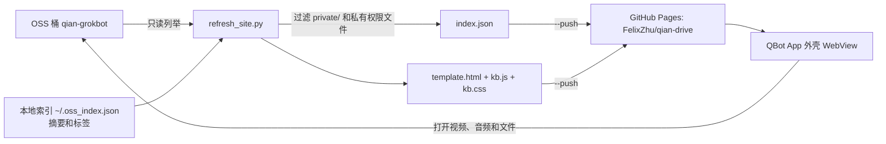
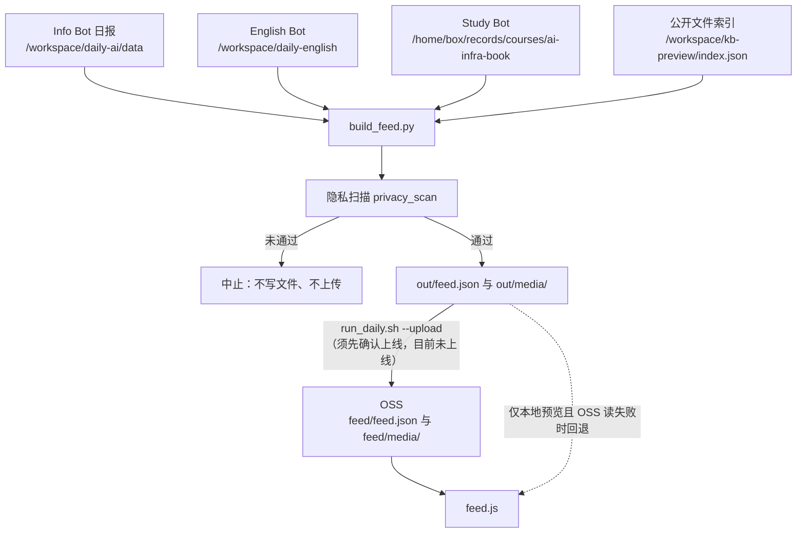
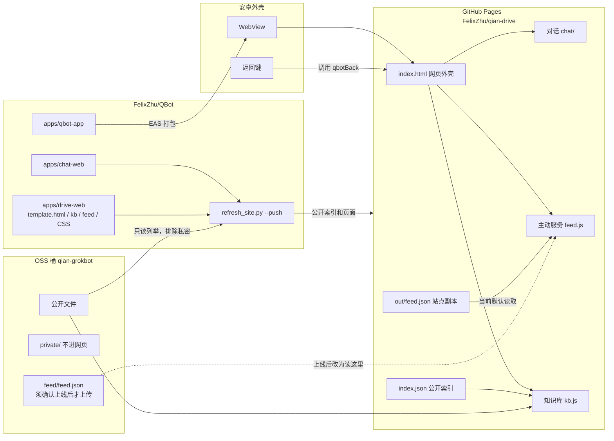

# QBot 代码架构

QBot 是装在折叠屏上的个人助手：安卓外壳只负责打开网页，三个 Tab 和几乎所有界面都在网页里。改界面就改网页、刷新就能看到；只有需要原生能力时才改外壳，并且提高 versionCode。

- 网页：https://felixzhu.github.io/qian-drive/
- 当前安装包：1.0.4（versionCode 6）
- 源码：公开仓库 [FelixZhu/QBot](https://github.com/FelixZhu/QBot)

本文说明整体结构、三个 Tab 的职责、数据怎么流动、以及怎样发布网页和打包 App。知识库、主动服务两节是对应模块负责人写的文档，全文收录。

## 概述

QBot 分两层：

1. **安卓外壳**（仓库里的 `apps/qbot-app`）：Expo SDK 58，用 `react-native-webview` 加载上面的网页。用 EAS 打预览 APK。当前版本 1.0.4，versionCode 6。本地打包目录是 `/workspace/qian-drive-app`。
2. **网页**（GitHub Pages 仓库 FelixZhu/qian-drive，由 `apps/drive-web` 生成）：三个 Tab——**对话**（默认）、**主动服务**、**知识库**。

原则：能放在网页里的改动都放网页，用户刷新即可更新；只有原生能力（返回键、退出提示、以后的通知和语音识别等）才改外壳。每次改外壳都必须提高 `versionCode`。

仓库是公开的，不能提交密钥或有版权的字体。访问 OSS 等服务的凭证只放在环境变量里，不打印、不写入文件。

## 网页外壳

外壳写在 `apps/drive-web/template.html`，负责 Tab 栏、折展布局、返回顺序，以及把三个模块挂进去。聊天界面在 `apps/chat-web`，构建后由外壳挂到对话 Tab。

### 三个 Tab 和折展

- **对话**（默认，`#panel-chat` / `#chat-root`）：和 QBot 聊天。
- **主动服务**（`#panel-feed` / `#tab-feed`）：全屏竖滑的卡片流。
- **知识库**（`#panel-kb` / `#tab-kb`）：文件检索和详情；打开文件时由外壳用原来的预览器显示。

折起来（宽度 < 600px）时，底部是 Tab 栏。展开（宽度 ≥ 600px）时，左边是 72px 宽的导航栏，右边是当前 Tab 的内容。各模块在展开时再自己做「左目录、右内容」。

Feed 和知识库是可选模块：站点上有 `feed.js` / `kb.js` 才加载。当前 Feed 挂载时读取站点上的 `out/feed.json`；等确认上线并上传到 OSS 后，再改为默认读桶里的 `feed/feed.json`。

### 隐藏 Tab、切换和返回

隐藏的 Tab 不会用 `display: none` 拆掉布局，而是 `visibility: hidden`，并加上 `inert`，避免被点到或读到。这样 Feed 和知识库在隐藏时仍能量到确定的高度，滚动位置也能保留。

每次切换 Tab，`setTab` 都会派发 `resize` 和自定义事件 `qbot:tab`（`detail.tab` 为当前 Tab 名：`chat` / `feed` / `kb`）。模块常常在面板还是隐藏、高度为 0 时就挂载，要靠这两件事在面板有高度后再排版。

返回由 `window.qbotBack` 统一处理。安卓返回键由外壳注入脚本调用它。顺序是：

1. 若文章或视频浮层开着（`window.qbotShell.isOpen()`），先关掉浮层并返回 `true`。Feed 的卡片序号和滚动位置不动。
2. 再关掉当前页的弹层、抽屉，以及知识库里已打开的旧预览器。
3. 再交给当前模块：`window.qbotKb.back()`、`window.qbotFeed.back()`、`window.qbotChat.back()`。返回 `true` 表示已经处理（例如退出详情、滑回第一张卡、关掉会话列表）。
4. 模块已经在自己的首页、返回 `false` 时，切回「对话」。
5. 已经在「对话」，并且聊天也没有可退的一步时，`qbotBack` 返回 `false`，外壳弹出「再滑一次退出」。

软键盘弹出时，外壳用 `visualViewport` 把整页 `#qbs` 钉在可视区域内，避免底部的输入框被键盘挡住。

### 对话 Tab

实现在 `apps/chat-web`，用 Vite + React，基于 assistant-ui。构建结果是 `chat/chat.js` 和 `chat/chat.css`，由网页挂到 `#chat-root`。

输入以语音为先、键盘为辅。默认是「按住说话」，点「Aa」改成打字。安卓 WebView 用不了浏览器自带的语音识别，麦克风目前会提示即将上线；正式方案是在外壳里做原生识别，再通过 `postMessage` 传给网页。

对话后端还没有定。界面只依赖一个 `ChatBackend` 接口，现在用的是本地模拟回复，用来看排版和「正在想」的状态。计划中的一种接法是：把对话交给 QBot 助手上的 webhook 例行任务，生成的回复写入 OSS，网页轮询取回整段答案。也可以改成流式（SSE 或直接的模型接口）。替换时只改一处接入。密钥只放环境变量，不写进仓库，也不出现在网页里。

折叠时，会话列表从左侧抽屉打开；展开（宽度 ≥ 600px）时，左边直接显示会话列表。返回键会先关掉这个抽屉。

## 共享设计系统

`tokens.css`、`layout.css`、`components.css` 放在 `apps/drive-web/`，由 `template.html` 全局加载，全站只有这一份。

- `tokens.css`：颜色、间距、圆角、字体。默认浅色；系统深色或 `<html data-theme="dark">` 时启用深色，并带一套深色 `--ft-*` 文件类型色，供知识库等图标使用。
- `components.css`：按钮、列表、目录树、搜索、标签等。类名一律加 `q-` 前缀，避免和旧网盘页已有的类名冲突。
- `layout.css`：外框布局。

## 知识库

本节全文收录知识库工程师的模块文档（`kb-tab` 分支提交 `1f93a3b` 的 `docs/kb-architecture.md`）。

### 1. 一句话
文件存放在阿里云 OSS 的 `qian-grokbot` 桶（北京区域）。发布脚本只读地列出公开文件，生成 `index.json`；网页里的知识库模块读这个索引，提供文件夹、搜索、标签筛选和详情页。私密文件不会进入网页。

### 2. 数据流


### 3. 代码位置（FelixZhu/QBot，`apps/drive-web/`）
| 文件 | 作用 |
|---|---|
| `refresh_site.py` | 列出 OSS 文件，排除 `_site/`、`trash/`、`_test/`、`private/` 和私有权限对象，再生成 `index.json` 和网页，`--push` 时发布 |
| `kb.js` | 知识库模块，挂载在 `#tab-kb` 上，没有任何依赖 |
| `kb.css` | 知识库样式，只使用设计 token（`--sp-*`、`--r-*`、`--ft-*` 等），自动适配深色模式 |
| `sample-index.json` | 脱敏的示例数据，用于本地预览和截图 |
| `live_check.py` | 检查线上页面 |

### 4. index.json 字段
`key`（OSS 路径）、`name`、`kind`（video/audio/pdf/…）、`doc_type`（中文类型）、`size`、`mtime`、`dir`、`summary`、`tags`、`private`（目前始终为 false）。顶层有 `base`（公开访问地址前缀）和 `count`。

### 5. 模块状态与交互
状态：`q`（搜索词）、`chips`（选中的标签，多个标签同时满足才显示）、`folder`（当前文件夹）、`selected`（当前文件）、`openFolders`（目录树的展开状态）。

| 场景 | 折叠（<600px） | 展开（≥600px，如 840） |
|---|---|---|
| 首页 | 顶部是搜索、标签和私密区入口，下面是文件夹和最近更新 | 左栏是搜索、标签、私密区和目录树，右栏是最近更新 |
| 详情 | 占满整屏，顶部有「‹ 返回」，视频和音频直接在页面里播放 | 右栏显示详情，左栏目录高亮当前文件 |
| 目录树 | 不显示 | 点名称进入文件夹，点箭头展开或收起 |

返回键约定：外壳先调用 `window.qbotKb.back()`。处理顺序是关闭弹层、退出详情、清空搜索词、回到上级文件夹，返回 `true` 表示已经处理；已经在首页时返回 `false`，由外壳切换 Tab。
对外打开文件：`window.qbotKb.open(key)` 会先调用 `window.qbotTab("kb")` 切到知识库 Tab，再打开该文件的详情。找不到文件或文件属于私密区时不改当前详情，并返回 `false`（Feed 的文件卡使用这个接口）。索引还没挂上时直接返回 `false`，不会切 Tab。
索引加载：没有 `window.KB_INDEX` 时请求 `index.json`。网络失败、HTTP 不成功，或正文不是带 `files` 数组的 JSON 时，只显示「打不开索引，检查网络后重试」和「重试」按钮，不渲染空目录。重试成功后按该索引正常挂载。滚动监听、`qbot:tab` 暂停播放和后台暂停只在每个根节点上登记一次，失败重试和再次 `KB.mount` 都不会重复登记。正文正好是 `{ "files": [] }` 时仍是空知识库，不是加载失败。
文件链接：用索引 `base` 拼对象键。键按 `/` 分段做百分号编码，空格、中文、`#`、`?`、`%` 编进路径，解码后仍是原来的对象键，不会变成片段或查询串。`base` 只接受 `http:` / `https:`；其它协议不生成链接，也不生成播放器地址。`base` 上的用户信息、查询串和哈希会去掉，避免把对象键吞进查询或片段。对象键里如果有单独的 `.` 或 `..` 路径段，标准网址会被浏览器折叠成别的对象（`%2E` / `%2E%2E` 也同样），详情里不提供打开链接，并写明原因。文件名里的普通小数点（如 `季度.观察.pdf`）不受影响。文件名、摘要和标签按文本插入。
筛选项在目录栏里换行排开。840 宽时目录栏只有 300px（600–719px 时 240px），单行再加右侧淡出会把末尾标签裁掉；换行后每个标签都能点到。
其他约定：收到 `qbot:tab` 事件且 `detail.tab` 不是 `kb`，或 App 进入后台时，自动暂停播放；滚动容器带有 `scroller` 类，避免被安卓下拉刷新抢走手势；私密区弹层可以下拉关闭；点击文件时派发 `kb:open` 事件，外壳可以接管。折叠（<600px，如 390）与展开（≥600px，如 840）的布局不变。
文件夹显示：长度 8 位以上的哈希目录名会被隐藏；常用目录显示中文名（报告、视频、B站视频、小宇宙播客、小红书、文档），和 Feed 卡片上的名称一致。

### 6. 隐私与安全
- 桶是公共读，但 `private/` 下的文件都设置为私有权限，网页和索引里都不会出现。
- 私密文件只能通过临时签名链接访问（最长 7 天），链接只私信发给 Qian，不写进仓库、记忆或 skill。
- 私密区入口目前显示「尚未配置」。下一步需要 Qian 创建只读 RAM 子账号，再和 IM 工程师确定解锁方式（例如设备指纹或口令），然后按需生成签名链接查看文件。
- 仓库是公开的，不提交密钥或有版权的字体；密钥只从环境变量读取，不打印。

### 7. 后续
1. 私密区查看流程（等 RAM 子账号）。
2. 全文检索：给 PDF 和文档抽取文本并生成摘要，写进索引的 `summary`，以后可以扩展成片段级检索。
3. 新文件入库后自动刷新索引，和主动服务的「新文件入库提醒」共用一个触发器。

## 主动服务

本节全文收录主动服务工程师的模块文档（`/workspace/qbot-feed/docs/feed-architecture.md`）。

### 概述

主动服务是 QBot 的第二个 Tab：全屏竖滑的卡片流，一屏一张卡。卡片来自 Info Bot 的 AI 日报、English Bot 的每日英语、Study Bot 的接着学，以及知识库里最近 7 天的公开新文件（合并成一张「N 个新文件」）。

内容由 `build_feed.py` 只读汇总成本地 `out/feed.json`，写入前会做隐私扫描；扫描不通过则不写文件、也不上传。上传到 OSS（`feed/feed.json` 与 `feed/media/`）需要显式加上 `--upload`，且须 Qian 确认「上线」后才能执行，目前尚未上线。

前端是独立模块 `feed.js` / `feed.css`，挂到外壳的 `#tab-feed`。现在线上外壳挂载时传 `feedUrl: "out/feed.json"`，读站点自带的那份；上线后改成读 OSS。不传 `feedUrl` 时默认读 OSS；仅在本地预览（`file:` / `localhost` / `127.0.0.1`）且请求失败时，才回退到站点上的 `out/feed.json`。模块不拥有底部 Tab 栏。静音和「稍后」只存在本机 `localStorage`。推送需克制，手机推送尚未实现。

### 数据流



构建时只读来源，不改原文件。英语音频和课程讲义会复制到 `out/media/`；讲解视频体积较大（约数十 MB），不复制进 `out/media/`。没有 `media.url` 时，前端只说明视频还没放进卡片，不编造地址。上传时，相对路径 `media/…` 或 `out/media/…` 会被改写成 OSS 公网地址 `https://qian-grokbot.oss-cn-beijing.aliyuncs.com/feed/media/<文件名>`。上传按文件 MD5 / 大小判断，未改动的对象会跳过。

### 代码位置和入口

工作目录是 `/workspace/qbot-feed/`（接到站点时，由 IM 工程师拷贝 `feed.js`、`feed.css` 和发布用的 `out/`）。

| 文件 | 作用 |
|---|---|
| `build_feed.py` | 汇总来源、隐私扫描、写出 `out/feed.json`；可选 `--upload` |
| `run_daily.sh` | 日常入口。默认只本地构建；`--upload` 时带上已审核索引并上传 |
| `feed.js` | 前端模块。导出 `window.QbotFeed` 与 `window.qbotFeed`（`mount` / `unmount` / `back`） |
| `feed.css` | 模块样式。依赖已上线的 `tokens.css`、`layout.css`、`components.css` |
| `out/feed.json` | 本地构建结果 |
| `out/media/` | 本地媒体副本（英语 mp3、讲义 md 等） |
| `preview.html` | 本地预览框，不替代外壳 Tab 栏 |
| `INTEGRATION_FIXES.md` | 需要外壳配合的约定说明 |

入口：

```bash
# 本地构建（默认索引 /workspace/kb-preview/index.json）
./run_daily.sh
# 或
python3 build_feed.py --index /workspace/kb-preview/index.json

# 上传 OSS：扫描失败会中止。在 Qian 确认「上线」之前不要执行。
./run_daily.sh --upload
```

可选参数：`--digest-limit N`（默认 1）、`--english-limit N`（默认 1）、`--index PATH`（只接受显式路径或默认的已审核公开索引，不会回退到旧的 `index.json` 副本）。

外壳挂载：

```js
QbotFeed.mount(document.getElementById("tab-feed"), { feedUrl: "out/feed.json" });
```

不传 `feedUrl` 时，模块默认请求 `https://qian-grokbot.oss-cn-beijing.aliyuncs.com/feed/feed.json`。`#tab-feed` 需占满内容区高度；`#panel-feed` 保持 `overflow: hidden`，由模块内部滚动。

### feed.json 字段

顶层：

| 字段 | 说明 |
|---|---|
| `generated_at` | 本次构建时间（ISO 8601，带时区） |
| `counts` | 各 `type` 的卡片数量 |
| `notes` | 构建说明（缺文件、回退来源、跳过的私密/过期条目等） |
| `cards` | 卡片数组 |

每张卡片：

| 字段 | 说明 |
|---|---|
| `id` | 稳定编号，如 `digest-2026-11-17`、`file-new-batch` |
| `bot` | 来源名称：`Info Bot` / `English Bot` / `Study Bot` / `QBot` |
| `type` | `digest` / `english` / `study` / `file` |
| `time` | 卡片时间，ISO 8601，须带时区。取内容自己的日期，见「时间规则」 |
| `title` | 标题 |
| `summary` | 摘要；新文件批量卡为空字符串 |
| `media.kind` | `none` / `audio` / `video` |
| `media.url` | 媒体地址；本地为相对路径 `media/…`，上传后改为 OSS 公网地址。只接受 http(s)，不接受 `javascript:`、`data:` 或带用户名口令的地址。没有这个字段时，前端不会编造地址 |
| `media.width` / `media.height` | 可选。视频在读到文件宽高之前，用它们撑开原始比例 |
| `open_url` | 主按钮打开的链接 |
| `private` | 是否私密。公开 feed 中必须为 `false`，否则扫描失败 |
| `data` | 类型专有字段 |

`data` 按类型：

- **digest**：`date`、`date_label`、`highlights`（最多 3 条，每条有 `title`、`category`）。`open_url` 指向 `https://ai-daily-ej4.pages.dev/archive/YYYY-MM-DD`。
- **english**：`date`、`date_label`、`expression`、`meaning`、`example`、`example_zh`。
- **study**：`course`、`day`、`total`、`brief`、`has_video`。`has_video` 为真但没有 `media.url` 时，卡片写明视频还没放进来，不播放。有 `media.url` 时按视频播放。
- **file**（当前只生成批量卡）：`subtype` 为 `new-batch`，另有 `count` 和 `files[]`。每条文件含 `name`（已去掉 BV 号等难看 ID）、`dir`（可读文件夹名，如「B站视频」「小宇宙播客」「xhs · 小红书」）、`key`、`kind`、`open_url`（知识库站点 hash 路径）、`time`。

### 卡片类型和排序

四类卡片及默认顺序（`TYPE_ORDER`）：

1. `digest`：AI 日报，来自 `/workspace/daily-ai/data/<date>/digest.json`，默认最近 1 份。
2. `english`：每日英语，来自 `/workspace/daily-english/`（优先 `<date>.txt`，否则 `video/lessons/` 下的 lesson JSON 或讲解脚本），音频为同日前缀的完整 mp3，默认最近 1 份。
3. `study`：接着学，来自 `/home/box/records/courses/ai-infra-book/` 的最新 `day-briefs/day-N.md` 与 `progress.md`；有对应讲解视频时只做标记，不复制视频文件。
4. `file`：公开新文件。只读取已审核索引 `/workspace/kb-preview/index.json`。跳过 `private/` 或标记为私密的条目；只保留入库/修改时间落在最近 7 天内的文件（优先索引里的 `ingested_at` / `added_at` / `ingested` / `added`，否则用索引里的 mtime，再否则只读查询 OSS `Last-Modified`）。按时间从新到旧最多收录 5 个，合并成**一张**卡，标题为「N 个新文件」，`open_url` 指向知识库站点。没有符合条件的文件时不生成文件卡。

同一类型内按 `time` 从新到旧。排序函数仍会把 `data.subtype === "due"` 的文件卡排到最前，但当前构建流程不会生成这类卡。

界面里：文件不超过 5 个时直接展开列表；超过 5 个时先展示前 5 条，并显示「还有 N 个」。主按钮是「打开知识库」；点某一行打开该文件。右上角标签为「新入库」，不再出现在标题下方或列表行里。

用户可点「稍后」（当天剩余时间不再出现该卡）或「不再提醒」（按类型静音）。状态存在 `localStorage` 键 `qbot-feed-snoozed` 与 `qbot-feed-muted-types`。点右上角「⋯」可恢复。

### 时间规则

卡片时间取内容自己的日期，并带时区，不使用构建时刻冒充发布时间：

- **日报**：digest 的日历日 + 元数据里的北京发布时间（`generated_at_bj` 或 `generated_at` 中的时分；缺省 08:00），时区 `Asia/Shanghai`。
- **英语**：课程日期当天的 `07:57`，时区 `Asia/Shanghai`。
- **接着学**：讲义与讲解视频二者较新的修改时间，转换到 `Asia/Shanghai`。
- **新文件卡**：所收录文件中最新一条的入库/修改时间，转换到 `Asia/Shanghai`。

前端展示一律按 `Asia/Shanghai` 计算「今天」「昨天」。卡片顶栏时间为「今天/昨天 HH:mm」；再早若仍在本周则用星期；否则用「M月D日 HH:mm」。卡片正文的日期标签与顶栏同一套规则（`今天/昨天 · 周X`，或 `M 月 D 日 · 周X`）。

### 隐私规则

公开 feed 只允许公开风格的内容（日报、英语、学习进度、已审核索引里的公开新文件）。私密文件提醒不进入这份 feed。

构建与上传前都会跑 `privacy_scan`。出现以下任一情况即失败（本地不写 `feed.json`，上传直接中止）：

- 任一卡片 `private === true`
- 任意字符串中出现 `private/` 路径（含 `open_url`、标题、摘要、媒体地址、文件 `key` / `dir` / `path` 等）
- 出现敏感词：「公司内部业务关键词（列表放在本地配置里，不入库）」

文件卡在进入 feed 之前就会跳过私密条目。OSS 密钥只通过环境变量交给 `oss.py`，本模块不打印、不写入 feed。仓库是公开的，不提交密钥。

### 交互

折叠（宽度 &lt; 600px）：只有全屏竖滑。一屏一张卡，`scroll-snap-type: y mandatory` 且 `scroll-snap-stop: always`。滑动容器绝对铺满舞台（`position: absolute; inset: 0`）。松手后若停在两张卡之间，会吸附到最近的整张卡。右侧有进度点，可点跳转。

顶栏只有一条，高 44px。左侧是「主动服务 · 当前卡的 Bot 名」，右侧是短时间和「⋯」。卡片里不再放头像、来源、日期或类型角标，标题只排一次。正文左右内边距 20px，从顶部对齐，不在卡片里垂直居中。

展开（宽度 ≥ 600px）：左边是按 Bot 分组的目录（头像、标题、Bot 名、时间，当前卡高亮），右边仍是同样的竖滑卡片流，共用上面这一条顶栏。点目录滚到对应卡；滑动右边时目录高亮跟着走。折展切换或旋转时保持当前卡。

桌面：滚轮一次翻一张（模块在滚轮处理里会 `preventDefault`）；键盘 `↑` / `↓` / `PageUp` / `PageDown` / `j` / `k` 翻页，`Home` 回到第一张，`End` 到最后一张，`Escape` 走与返回键相同的逻辑。

音频同时只播一条，视频也是。切到另一张卡、收到 `qbot:tab` 且目标不是 feed、页面被隐藏（`visibilitychange`）或进入 `pagehide` 时暂停。外壳若在 App 进后台时派发 `qbot:appstate`（`detail.state` 为 `background`、`inactive` 或 `hidden`），模块同样暂停。切回 feed 时重新按当前卡排版，位置保留。

滑动松手时：位移超过视口高度的 15%，或速度超过 0.3px/ms，就翻到相邻那一张；否则吸附到最近的整张卡。判断只在 `touchstart` / `touchend` 上用被动监听完成，纵向 touch 不调用 `preventDefault`，原生 `scroll-snap` 仍然保留。不把整条音频播放器排除在外：只有进度条和按钮不翻页，点在空白处或时间文字上仍会翻页。

视频在卡片里点按播放，按文件原始宽高比显示，可暂停、拖动进度和全屏。`has_video` 为真但没有地址，或地址打不开时，卡片说明暂时不能播。

主按钮：日报和接着学里的同源正文在 App 内排出来，不使用 iframe。外部 http(s) 地址不会赋给任何 iframe（包括隐藏的探测框）。空沙箱不能证明 Android 1.0.4 注入到子框架里的 Java 接口已经消失，所以这里不靠沙箱去隔离，而是根本不加载外部页面。已安装外壳若提供 `window.qbotShell`（接口在 IM 的模块里，本文件不改外壳）：打开文章调用 `qbotShell.openArticle(url)`，由它显示说明；「用浏览器打开」调用 `qbotShell.openExternal(url)`。没有这套接口时，Feed 自己写出同样的说明，按钮退化为 `window.open(url, "_blank", "noopener,noreferrer")`。不声称任意远程网页能在旧 App 里渲染。英语仍是播放/暂停。文件卡的「打开知识库」直接调用外壳的 `window.qbotTab("kb")`。点某个文件行时，先调用 `window.qbotKb.open(key)`（`key` 为公开索引里的 OSS 路径，与知识库 `files[].key` 完全一致；该函数内部会自己切 Tab 并打开详情，找不到或私密文件返回 `false`）。若 `qbotKb` 不存在，或 `open` 返回 `false`，再退化为 `qbotTab("kb")`。文件不会因此打开系统浏览器。

返回键由外壳调用 `window.qbotFeed.back()`，阅读页优先：

1. 若 App 内阅读页开着，先关掉，滚回打开前的那张卡和当时的 `scrollTop`，返回 `true`；
2. 否则若菜单开着，先关掉，返回 `true`；
3. 否则若密钥弹层开着，先关掉，返回 `true`；
4. 否则若不在第一张卡，立刻滚回第一张，返回 `true`；
5. 已在第一张，返回 `false`，由外壳切回「对话」。

### 和外壳的约定

- 纵向 touch 上，feed 不调用 `preventDefault`（只在鼠标滚轮和键盘翻页时拦截）。外壳也不要在纵向 touch 上 `preventDefault`。
- `#panel-feed` 保持 `overflow: hidden`，不要让外壳自己滚。一屏一张卡的吸附由 feed 内部完成。
- 滚动容器 `.q-feed`（展开时右侧实际在滚的也是它）带有 class `scroller`，让旧外壳的下拉刷新选择器能认出它，避免在卡片中间下拉时整页重载。
- 切到知识库用外壳导出的 `window.qbotTab("kb")`（即 `template.html` 里的 `setTab`）。打开某个公开文件时先调用 `window.qbotKb.open(key)`（它内部会再调 `qbotTab("kb")`）；接口不存在或返回 `false` 时，退化为只切 Tab。不要用 `window.open` 打开知识库或站内文件。
- Feed 通常在页面加载时就把模块挂到 `#tab-feed`，此时面板往往是隐藏的，高度为 0。外壳每次切 Tab 都应派发 `resize` 和 `qbot:tab`（`detail.tab` 为当前 Tab 名）。模块会监听这两件事，并用 `ResizeObserver` 在容器有高度后再对齐到当前卡。
- 离开 feed 时停音频和视频，由 feed 在 `qbot:tab` 里自己处理。页面隐藏和 `pagehide` 也会暂停。外壳可以另外派发 `qbot:appstate`（见上），当前 `apps/qbot-app/App.tsx` 还没有派发这个事件，因此 App 进后台时是否暂停取决于 WebView 会不会让页面变成 hidden。
- Feed 不把外部地址放进 iframe，也不要外壳做跨源代理。`qbotShell.openArticle(url)` 和 `qbotShell.openExternal(url)` 由外壳提供时才调用。没有外壳接口时，「用浏览器打开」是 `window.open(url, "_blank", "noopener,noreferrer")`。
- 返回顺序接 `window.qbotFeed.back()`。阅读页的关闭和回到原卡都在这个函数里，外壳不用再实现。

### 定时任务和推送

计划每天北京时间约 8:15 运行 `run_daily.sh --upload`，重新构建并在扫描通过后更新 OSS 上的 `feed/feed.json` 与 `feed/media/`。前提是 Qian 本人确认「上线」。目前尚未上线，也尚未创建这条定时任务。

推送要克制。卡片上的「稍后」和「不再提醒」只作用于本机 feed，不会向其他设备或联系人发消息。手机推送还没有做。

### 后续计划

- 私密文件提醒卡：等知识库的加密和本地密钥方案就绪后再接；现在的密钥弹层只是占位。
- 讲解视频：前端已经能播 `media.kind = "video"` 且带有 http(s) `media.url` 的卡片，比例跟文件走，不再预留 9:16 裁切框。本仓库没有那条约 36MB 的学习视频，也没有 `build_feed.py` 这条汇总管道（它在协调机上，不在这个公开仓库）。因此这里不能把真实文件接进 feed，也没有上传到 OSS。公开测试只用 `apps/drive-web/fixtures/` 里生成的合成短片。管道要在协调机上把真实地址写进 `media.url` 之后，卡片才会播到那条片子。
- 手机推送：用 expo-notifications 加 FCM，仍然保持克制，不会默认频繁推。

界面检查：`node apps/drive-web/test/feed-redesign.mjs`。它用本机 Chrome 打开合成 fixture，覆盖 390/840 浅色与深色顶栏、视频播放暂停全屏、无地址和打不开的视频、切 Tab / 后台暂停、阅读页开关与被禁止的跨源页、文件跳转、进度条与滑动，以及返回键和菜单。

## 整体数据流



三点补充：

- 发布脚本只读 OSS，不往桶里写文件。
- 当前线上 Feed 读的是站点上的 `out/feed.json`；OSS 上的 `feed/feed.json` 还没有上线。
- 对话的真实后端尚未接入；计划中的一种接法是把回复写到 OSS，由网页轮询读取。

## 发布与打包

**网页。** 在仓库里执行：

```bash
python3 apps/drive-web/refresh_site.py --push
```

脚本会：

1. 构建对话 Tab（`apps/chat-web` 的 Vite 产物，拷到站点的 `chat/`）。
2. 只读列举 OSS 桶 `qian-grokbot`（北京），排除 `_site/`、`trash/`、`_test/`、`private/`，以及不是公共读的对象。
3. 生成公开的 `index.html`、`index.json`（公开索引里不会出现私密文件名），并拷贝设计 CSS、`kb.js` / `kb.css`、`feed.js` / `feed.css`，以及本地的 `out/feed.json` 和 `out/media/`。
4. 写到 `/workspace/qian-drive-repo`（同时写一份到 `apps/drive-web/dist`）。有改动则提交并推到 FelixZhu/qian-drive。
5. 生成 `version.json`。已打开的页面在回到前台时若发现版本变了，会自动刷新。

凭证来自环境变量，脚本不打印、也不写入任何文件。

**App。** 在 `/workspace/qian-drive-app` 用 EAS 打预览 APK（`preview` 配置，内部分发）。源码对应仓库里的 `apps/qbot-app`。只改网页时不必重新装包，刷新即可；改了外壳则必须提高 `versionCode` 再打新包。

## 外壳与模块的约定

所有模块共同遵守：

- 每次切 Tab，外壳都派发 `resize` 和 `qbot:tab`（`detail.tab` 为 `chat` / `feed` / `kb`）。
- 返回键统一走 `window.qbotBack`。模块通过 `back()` 返回 `true` 或 `false`，告诉外壳这一步有没有处理完。
- 外壳不要在纵向触摸上调用 `preventDefault`，以免打断 Feed 竖滑。

**主动服务：**

- 纵向 touch 上，feed 不调用 `preventDefault`（只在鼠标滚轮和键盘翻页时拦截）。
- `#panel-feed` 保持 `overflow: hidden`，并有确定的高度，不要让外壳自己滚。一屏一张卡的吸附由 feed 内部完成。
- 收到 `qbot:tab` 且目标不是 `feed` 时，模块自己停掉音频和视频；切回 feed 时重新按当前卡排版，位置保留。`qbotFeed.back()` 会先关掉阅读页，再关菜单和弹层，最后才滚回第一张卡。

**知识库：**

- 收到 `qbot:tab` 且目标不是 `kb` 时，暂停页面里的音视频。这里必须监听 `qbot:tab`（从 `kb-tab` 的 `3ac906c` 起），不能再用 IntersectionObserver 判断是否离开 Tab——隐藏 Tab 改成 `visibility` + `inert` 之后，那种写法不会生效。
- 点击文件时派发 `kb:open` 事件（带上文件的 `key` / `path`），由外壳用原来的预览器打开。

## 文章和视频（外壳）

主动服务一节仍由该模块负责人维护，这次没有改 `feed.js` / `feed.css`。日报主按钮现在的 `window.open(url, "_blank", "noopener")` 保持原样，由网页外壳接住。

安装包仍是 **1.0.4（versionCode 6）**。下面的行为在网页里，刷新即可，**不需要新 APK**。`apps/qbot-app` 没有改。

### 原因

`react-native-webview` 14.0.1 在安卓上处理新窗口时，会建一个没有挂到界面上的 WebView，并且只重写了已废弃的 `shouldOverrideUrlLoading(WebView, String)`。`window.open` 的第一次加载经常根本不进这个回调，所以 `onOpenWindow` 不触发，文章既不会出现在 App 里，也不会交给系统浏览器。Feed 里的音频走 `new Audio()`，不经过这条路径，所以音频是好的。

同一份页面在无头 Chrome 里量过：`feed.js` 给视频槽的 class 是 `q-vframe`，`feed.css` 写的是 `.vframe`。没被样式命中的 `<video>` 是浏览器默认的 300×150；按 `.vframe` 画出来的框是 200×356（9:16）。这是 Feed 样式的事，外壳不去改那两个文件。

跨域 iframe 也量过：允许嵌入的 example.com、带 `X-Frame-Options: deny` 的 github.com、以及 example.com 的 404，父页面都只看到 `load` 和 `SecurityError`，没有 `securitypolicyviolation`。成功和拒绝长得一样。外壳不会假装自己能分辨，也不会去代理或改写对方的响应。

### 外壳负责

`apps/drive-web/shell-media.js` 挂到 `window.qbotShell`：

| 方法 | 作用 |
|---|---|
| `capabilities()` | 能力说明。`requiresNewApk` 为 `false`。 |
| `openArticle(url)` | 任意外部 http(s) 网页不嵌进这个 WebView。面板说明原因，并给出浏览器按钮。直接视频文件改走播放器。空沙箱不是安卓 Java 接口已消失的证据，这里没有在真机上证明过。 |
| `openExternal(url)` | 只对 http(s) 交给系统浏览器。PR 4 的「用浏览器打开」调用 `window.open(url, "_blank", "noopener,noreferrer")`，外壳把它当成这一条，而不是再嵌一次。当前 Feed 主按钮只有 `noopener`，外壳先给出说明面板。 |
| `playVideo(url)` | 带控制条的内嵌播放器，`object-fit: contain`，按视频自身宽高比。全屏走元素的 `requestFullscreen` / `webkitEnterFullscreen`（当前 APK 已开 `allowsFullscreenVideo`）。 |
| `close()` / `isOpen()` | 关掉浮层。返回键先走这里。 |

只接受 `http:` 和 `https:`。`javascript:`、`data:`、`file:`、`content:`、`intent:`、`blob:`、`about:` 直接拒绝，不会交给 WebView。地址里的用户名和密码会去掉。

浮层在 390 宽（小于 600）盖住整个壳，包括底栏；在 840 宽（≥ 600）左缘让出 72px 导航轨。顶栏高 44（`--touch`）。

视频离开时暂停：切走 Feed / 知识库 Tab、页面隐藏、打开浮层，以及 Feed 里该 `<video>` 可见比例低于 0.5。这补的是 `<video>`。Feed 自己的 `Audio()` 仍由 `feed.js` 在切卡和 `qbot:tab` 时停。

Feed 里的 `<video>` 如果布局高度小于 180 或宽度小于 160（默认 300×150 会命中），用户一点播放就改到外壳播放器，并暂停那个小元素。Feed 把槽画到大于这个尺寸之后，播放留在卡片里，外壳不接管。

### 打不开时

- 能确定的失败会换成说明，并给出「在浏览器中打开」：协议不对、加载超时、iframe 仍停在可读的 `about:blank` 或 `chrome-error:`、`<video>` 的 `error`、以及 `.m3u8` / `.mpd` / `.mkv`。
- 跨域框架只是 `SecurityError` 时，留下真正的 iframe，并写明：如果是空白，就是对方不允许嵌入，请用浏览器。不注入文章正文。
- 浏览器按钮在 App 里调用 `location.assign`。1.0.4 的 `onShouldStartLoadWithRequest` 会把非本站顶层导航交给系统浏览器并取消加载，Feed 页面还在。同时会 `postMessage({type:"open-external"})`，但 **1.0.4 不认识这条消息**。桌面浏览器则用原来的 `window.open`。

### Feed 负责人要做的

- 可以继续用现在的 `window.open`。更明确的接法是 `qbotShell.openArticle(url)` / `qbotShell.playVideo(url)`，返回 `{ok, mode, reason, url}`。
- 内嵌视频请自己把 `q-vframe` 和 `.vframe` 对齐，并保持 `controls` 和 `playsinline`。槽有了真实尺寸后，外壳不会把播放拿走。
- 切卡时停掉自己的 `Audio()`。`<video>` 的暂停外壳会做；若卡片逻辑还要同步按钮状态，仍由 Feed 自己停。
- 讲义和知识库文件继续走 `qbotTab` / `qbotKb`，不要 `window.open`。
- 不要期待外壳绕过 `X-Frame-Options` 或 CSP `frame-ancestors`。被拒绝时用浏览器按钮。

### 安卓上仍然的限制

- 内嵌视频走系统 WebView 的媒体栈，不是 ExoPlayer。H.264/AAC 的 MP4、VP8/VP9 的 WebM 一般能播。HEVC、HLS、DASH、DRM 经常不能，外壳只显示 `<video>` 的错误，不转码。
- 页面是 https。APK 的 `mixedContentMode` 是 `MIXED_CONTENT_NEVER_ALLOW`，http 媒体会被 WebView 拦住。
- `allowsInlineMediaPlayback` 只对 iOS 有效。安卓 WebView 默认内嵌播放。
- 全屏依赖当前 APK 里已经打开的 `allowsFullscreenVideo`。没有为全屏发新包。
- APK 为了下拉刷新把 WebView 放在 ScrollView 里（`nestedScrollEnabled` 已开）。这次没改原生。若某台机器上内嵌控制条仍然点不到，那才需要改外壳并提高 `versionCode`。
- 切 Tab 时不能靠 IntersectionObserver 判断离开（隐藏用的是 `visibility` + `inert`）。外壳暂停视频听的是 `qbot:tab` 和 `visibilitychange`。

## 外观

手机系统是浅色、QBot 却是深色，有两条互不依赖的原因：

1. **存下来的选择。** 旧的月亮按钮在知识库侧栏 `#btnTheme` 里。知识库模块加上 `kb-mode` 之后，整块 `.side` 是 `display: none`，三个 Tab 都点不到它。那个按钮只会在「当前看起来是深色」和「浅色」之间切换，并写入 `localStorage` 的 `qd2_theme`。一旦写成 `"dark"`，就盖过系统，而且没有入口改回来。默认值仍是 `"auto"`；没人点过按钮时，不会自己变成 dark。
2. **系统同步。** `"auto"` 看的是 WebView 的 `prefers-color-scheme`，不是设置 App 里那一颗开关的原文。已安装的 1.0.4 不会把系统夜间模式另外传给网页。媒体查询在回到前台时有时不发 `change`。这次在 `change`、页面重新可见、`pageshow` 和 `focus` 时重新读一次。若 WebView 自己报错，网页无法猜到手机真实设置。

外壳在底栏（宽度 &lt; 600，含 390）和左侧轨（≥ 600，含 840）放了 **外观**，三个 Tab 共用。选项是 **浅色**、**深色**、**跟随系统**。只写入 `qd2_theme`，不动其他 localStorage。已经存成 `dark` 或 `light` 的值原样保留，菜单里能看到当前项，可以改成跟随系统。不会清空、也不会强制改回 auto。

显式浅色或深色始终生效。只有跟随系统才跟 `prefers-color-scheme`。`<html data-theme>` 写成决定后的 `light` 或 `dark`（现有 tokens、feed.css、网盘的 `--d-*` 不用改），`data-theme-mode` 记下选择。

状态栏颜色仍由 1.0.4 外壳的 `useColorScheme()` 决定，这次没改原生，也没有在真机上核对。若状态栏和网页不一致，或跟随系统始终跟错，需要另一次外壳改动并提高 `versionCode`。
