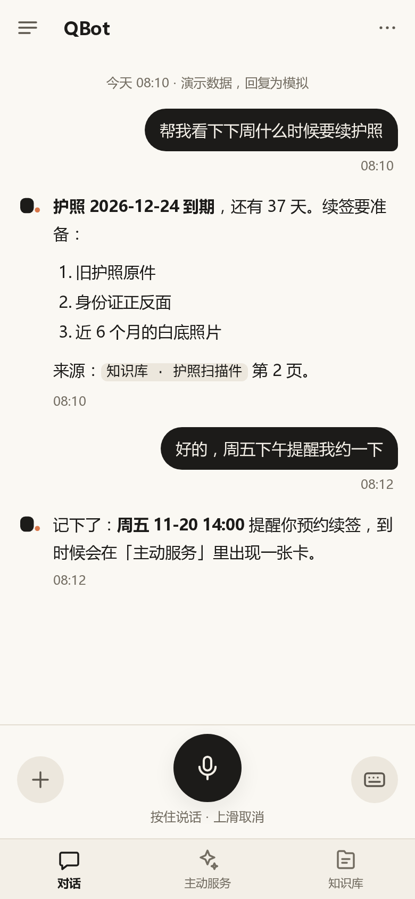
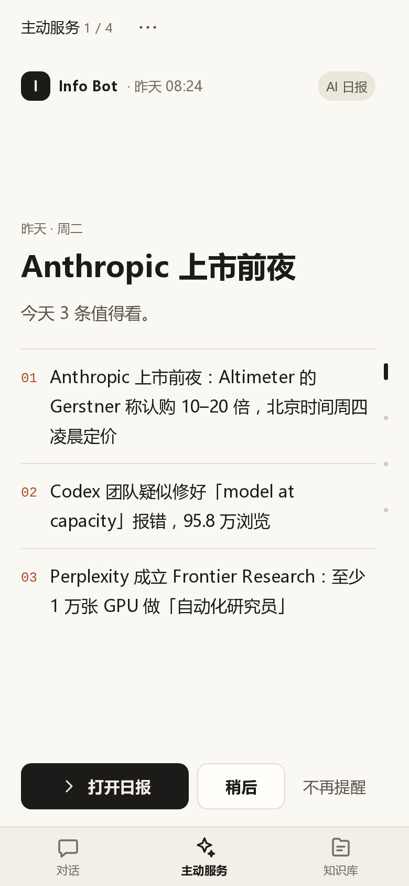
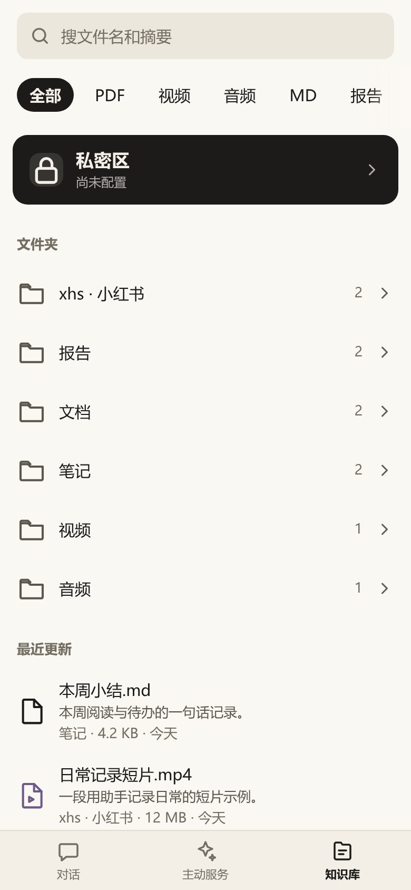
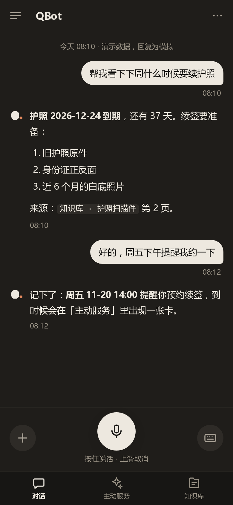
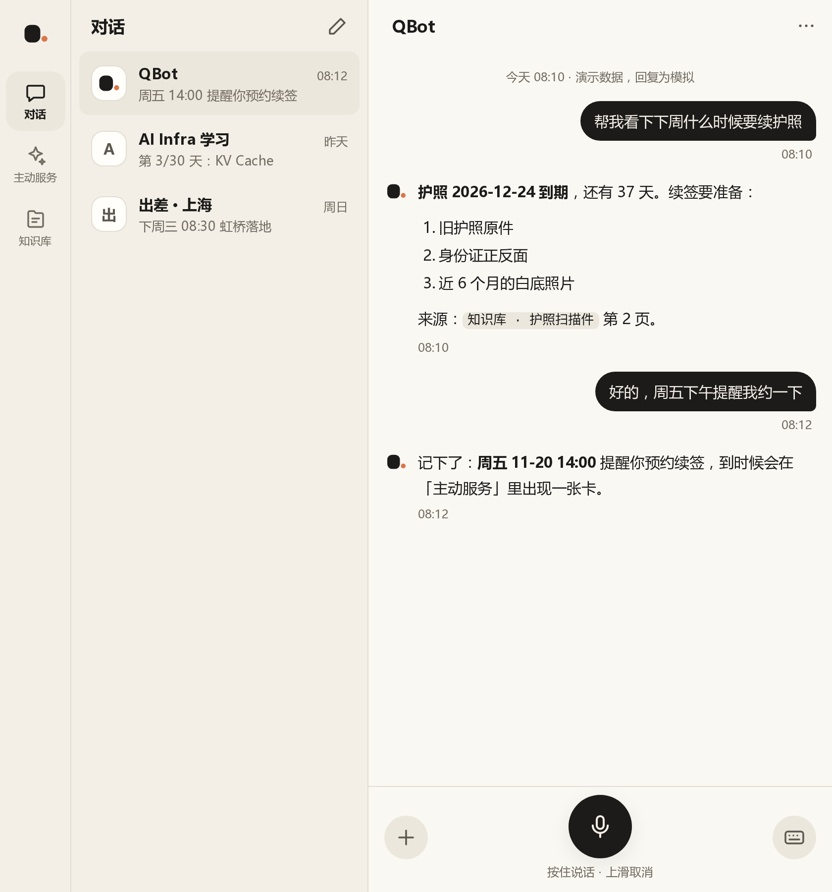
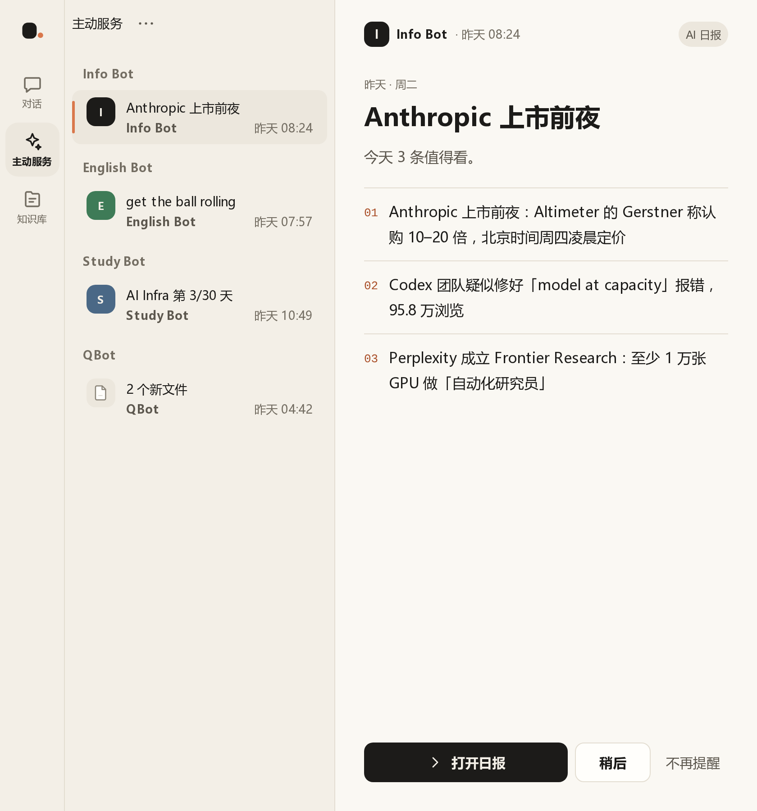
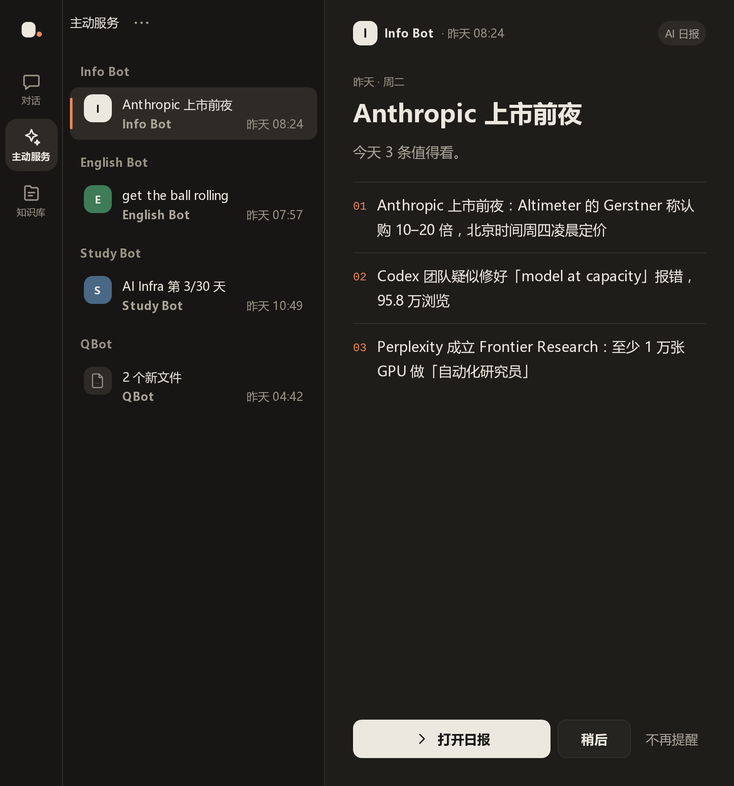
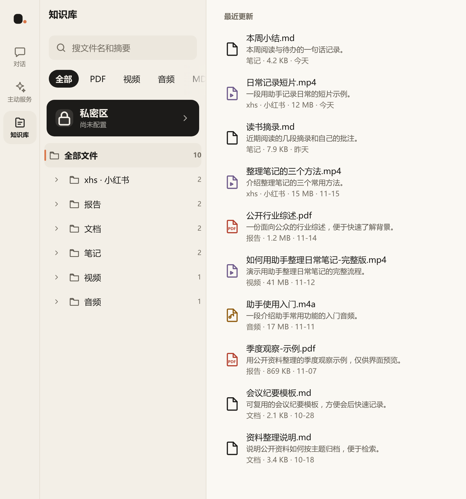

# QBot 设计文档

**结论**：QBot 的界面是一张奶白色的纸，墨色做主按钮，陶土橙只做「那个点」。三个 Tab（对话 / 主动服务 / 知识库），默认「对话」。折叠（约 390px）用底部 Tab，展开（约 840px）换左侧 72px 图标栏，同一套 token，只换布局。本文是给公开仓库 `docs/DESIGN.md` 用的精简规范，数值全部来自 `tokens.css`、`BRAND.md`、`SPEC.md` 和已落地的交互（`ix-fixes` `7369537`）。

配套：代码架构见 `docs/ARCHITECTURE.md`。协作和验收以根目录 `README.md` 为准。本文的尺寸是实现参考，不是像素级合同。

---

## 1. 概述与原则

QBot 是 Qian 的私人助理：安静、可靠、先给结论。观感追求克制、干净、偏高端的工具感，可类比常见 AI 工作台的留白与层级，但不复制任何现有品牌的造型、配色或组件。

三条原则：

1. **克制**：大面积奶白 + 墨色；陶土橙只用在未读、选中、录音、高亮，整屏不超过 2 处。
2. **结论先行**：标题说结论，正文给日期、数字、来源；不写客套话。
3. **一套规范，两种形态**：折叠和展开共用 token，只换布局。

文案：用「你」不用「您」；不用感叹号、不卖萌。按钮用动词 2–4 字。错误说人话并给出下一步，例如「打不开，网络断了。重试」。时间写作「今天 08:12 / 昨天 / 周日 / 11-04」，出差时按当地时间显示。

---

## 2. 品牌

图标构成：奶白底 `#F3EFE7` + 墨色圆角块 `#1C1B19`（块圆角约等于块宽的 38%）+ 陶土圆点 `#D9774B`（直径约等于块宽的 19%，在块的右下外侧，与块底部对齐并略偏上）。矢量稿见 `apps/qbot-app/icon-options/` 方案 C 与设计侧 `assets/brand-mark.svg`。

- 四周至少留 1 个圆点直径；完整标最小 16px，更小时只留墨块。
- 深色背景：墨块反白为 `#EDE8DF`，圆点用 `#E58A5E`。
- 通知小图标：单色白 + 透明（`assets/notif-small-icon.svg`），由系统着色；不要放彩色或带底色的图。
- 不要：拉伸变形、给圆点换色或加渐变阴影、把圆点放进块里、再用旧的紫色文件夹 logo。

---

## 3. 设计变量

源文件：`tokens.css`。页面跟随系统的 `prefers-color-scheme`。`<html data-theme="light|dark">` 是解析后的浅色或深色，`data-theme-mode` 保持 `auto`。导航里没有外观项。以前存下的浅色或深色选择不会再锁住页面。

### 3.1 颜色

主色是陶土橙 `#D9774B`，但它是点缀色，不是填充色。主按钮用墨色块（呼应图标里的黑块）。陶土橙在奶白上对比只有 2.96:1，不能承载小字；墨色按钮对比 15:1。

| 角色 | token | 浅色 | 深色 |
|---|---|---|---|
| App 底、侧栏、状态栏、启动页 | `--bg` | `#F3EFE7` | `#171614` |
| 内容区 | `--surface` | `#FAF8F3` | `#1F1D1A` |
| 卡片、输入框 | `--surface-raised` | `#FFFEFB` | `#262420` |
| 选中 / 标签底 | `--fill` | `#ECE7DD` | `#2E2B27` |
| 分隔线 | `--line` | `#E3DDD1` | `#34312C` |
| 正文 / 标题 | `--text-1` | `#1C1B19`（16.2:1） | `#EDE8DF`（13.8:1） |
| 次要 | `--text-2` | `#5C574E`（6.8:1） | `#ABA498`（6.8:1） |
| 元信息（≥12px） | `--text-3` | `#736D62`（4.8:1） | `#9A9386`（5.5:1） |
| 陶土点（仅图形） | `--accent` | `#D9774B` | `#E58A5E` |
| 陶土字 / 链接 | `--accent-ink` | `#A94E27`（5.2:1） | `#E58A5E`（6.5:1） |
| 主按钮底 / 字 | `--btn-primary-*` | `#1C1B19` / `#F3EFE7` | `#EDE8DF` / `#171614` |
| 成功 / 警告 / 危险 / 信息 | — | `#3E7B57` `#8F5B0E` `#B3402E` `#4A6886` | 同色系提亮 |

正文对比均 ≥ 4.5:1（WCAG AA）。焦点环：`--focus-ring: 0 0 0 3px rgba(217,119,75,.35)`。

### 3.2 文件类型色 `--ft-*`

只用在类型角标和图标描边，不做大块填充。深色值在 `#171614` 上对比均 ≥ 6:1。

| token | 浅色 | 深色 |
|---|---|---|
| `--ft-folder` | `#5C574E` | `#ABA498` |
| `--ft-pdf` | `#B3402E` | `#E2806B` |
| `--ft-doc` | `#4A6886` | `#8EAACB` |
| `--ft-md` | `#1C1B19` | `#ECE7DD` |
| `--ft-image` | `#3E7B57` | `#7FBA96` |
| `--ft-video` | `#6E5A8A` | `#AE99CF` |
| `--ft-audio` | `#8F5B0E` | `#D6A050` |
| `--ft-code` | `#5B6470` | `#A3ABB7` |
| `--ft-sheet` | `#3E7B57` | `#7FBA96` |
| `--ft-other` | `#8A8478` | `#9A9488` |

图标：线性，24 网格，描边 1.75，圆头圆角；选中不换实心，只改颜色并加底。文件是纸张轮廓 + 底部类型字。私密文件在图标右下加 16px 墨色圆形锁徽标（带 2px 底色描边）。不混用 emoji 当图标。

### 3.3 字体

```css
--font: "Microsoft YaHei","微软雅黑","PingFang SC","Noto Sans SC","HarmonyOS Sans SC",system-ui,sans-serif;
--fw-regular: 400;
--fw-bold: 700;
```

雅黑只有 400 / 700 两档，不要写 500 或 600。字体文件因版权**不打进公开的 QBot 仓库**；若发布站点需要子集，只放在独立的 Pages 仓库，不提交到本仓。

字号（px / 行高）：说明 12/18 · 元信息 13/20 · 正文 15/24 · 阅读 16/28（行高 1.75）· 小标题 17/24 · 页标题 20/28 · 大标题 26/34。主动服务大标题 28/38。中文正文行高 1.6–1.75。数字与单位之间留半角空格（如「7 天」）。

### 3.4 间距、圆角、触控、动效

- 间距是 4 的倍数：4 / 8 / 12 / 16 / 20 / 24 / 32 / 40 / 48。页面左右边距：折叠 16–20，展开 32。
- 圆角：6 角标 · 10 行 / 输入 / 按钮 · 14 卡片 · 20 弹层 / 气泡 · 全圆用于标签和语音键。
- 阴影只给浮层（`--shadow-1/2/3`）。卡片用 1px 线，不用阴影。
- 触控目标 ≥ 44px（`--touch`）；列表行 48–56px；顶栏 52；底部 Tab 56 + 安全区；展开态图标栏 72、中栏 300（窗口 600–719px 时收为 240，电脑 ≥1024px 时 320）。
- 安全区使用 `env(safe-area-inset-*)`。
- 动效：120ms 按下 / 200ms 切换 / 280ms 抽屉弹层；曲线 `cubic-bezier(.2,.8,.2,1)`。只做位移和透明度。系统「减少动态效果」时时长为 0。品牌动效只有一个：「QBot 正在想」——墨块 + 陶土点 2.4s 慢呼吸；超过 15 秒补一行「还在整理，大约 1 分钟」。

### 3.5 深色模式

同时支持：

- `@media (prefers-color-scheme: dark)`，且 `:root:not([data-theme="light"])` 时套用深色变量；
- `:root[data-theme="dark"]` 强制深色。

深色原则：墨色做底，奶白做字，陶土橙稍提亮（`#E58A5E`）。

---

## 4. 命名约定

| 前缀 | 用途 | 例子 |
|---|---|---|
| `q-` | 组件类，可全局加载 | `.q-btn.q-primary`、`.q-chip.q-on`、`.q-fcard` |
| `qb-*` | 外框 / 布局类 | `.qb-app`、`.qb-nav`、`.qb-pane`、`.qb-topbar`、`.qb-sheet` |
| `is-*` | 状态类，只和 `.qb-app` 组合 | `.qb-app.is-drawer`、`.qb-app.is-sheet`、`.qb-topbar.is-scrolled` |

外壳落地时另有一套 `qbs-*`（`.qbs`、`.qbs-nav`、`.qbs-item`、`.qbs-panel`），语义与 `qb-*` 相同：折叠底部 Tab，展开左侧 72px 栏。不要把未加前缀的 `.card`、`.btn`、`.toast` 和新组件混用。

---

## 5. 信息架构

三个底部 Tab，默认「对话」：

1. **对话**：会话流 + 语音优先输入。首次进入可出现密钥设置页（Webhook 密钥、只读密钥，只存在这台手机上）。
2. **主动服务**：全屏竖滑卡片，数据来自站点的 `feed.json`（上线后改为读对象存储）。
3. **知识库**：搜索、标签、文件夹、最近更新；私密区单独入口。

**私密区**：先放体检报告和证件。私密文件放在 `private/` 下，不进公开索引和网页，打开时用临时签名链接（最长 7 天），链接不写进仓库。入口在未配置时显示「尚未配置」，不要弹出密钥框。公开 Feed 不含私密内容；扫描时若出现 `private/` 路径，或出现体检、护照、证件、身份证，以及公司内部业务关键词（列表放在本地配置里，不入库），构建会失败。

返回键总顺序：先关弹层，再回到当前模块的首页（Feed 是第一张卡，知识库是详情 / 文件夹的逐级返回），最后回「对话」。再滑一次才退出应用。

---

## 6. 折叠与展开布局

断点沿用现有 599 / 600。验收宽度：折叠 390×844，展开 840×900。

| | 折叠（外屏，约 360–420px，&lt;600） | 展开（内屏，约 700–900px，≥600） | 电脑 ≥1024 |
|---|---|---|---|
| 导航 | 底部 Tab 56px + 安全区 | 左侧图标栏 72px，顶部品牌标，选中项 `--fill` 圆角底 | 同展开 |
| 中栏 | 抽屉（左滑出，86vw ≤320） | 常驻 300px（600–719px 时 240） | 320px |
| 内容 | 单栏，顶栏 52px 一行 | 右侧，阅读宽 ≤720 居中 | 可显示文档标签页 |
| 弹层 | 底部弹层（圆角 20，抓手） | 居中对话框 440px | 同展开 |

各 Tab：

- **对话**：折叠是单栏对话 + 底部输入；展开时左侧会话列表（头像 36 + 名称 + 最后一句 + 时间），右侧对话最大宽 640 居中。展开时对话抽屉会关上。
- **主动服务**：折叠是一屏一卡、上下滑，右侧 4px 进度点。展开是左边按 Bot 分组的目录，右边仍是竖滑卡片流（类似短视频的整屏翻页）；目录高亮跟着当前卡走，点目录跳到对应卡。折展切换时保持当前卡。
- **知识库**：折叠首页是搜索、标签、私密区入口、文件夹、最近更新；点进详情占满整屏。展开时左栏是搜索、标签、私密区和目录树，右栏是最近更新或详情。

顶栏一行 52px，标题左对齐 17px 粗体；左侧菜单或返回，右侧最多 2 个图标按钮。默认无分隔线，内容滚动后才出现 1px 线。折叠态不再叠「标签栏 + 面包屑栏 + PDF 工具栏」三层。

---

## 7. 各 Tab 交互

依据 `ix-fixes`（`7369537`）以及知识库 `kb.js`（须用 `3ac906c`，不要用 `b53b1f2`）、Feed 模块文档。本地没有单独的 `INTERACTION-QA-2026-11-17.md`。

### 7.1 对话

- 用户气泡：墨底奶白字，右对齐，圆角 20，最大宽 78%；连续消息合组，只最后一条带尾角。
- QBot 回复不加气泡，左侧 24px 品牌标，正文直接排在内容区，可带附件卡。同一组只在最后一条下显示时间；跨 5 分钟以上插日期分隔。思考态不显示时间，回复到达后再显示。回复整段到达后用 200ms 淡入，不做逐字打出。
- **语音优先**：默认中间 64px 墨色麦克风（按住说话、上滑取消），左「+」附件，右「Aa」切键盘。只有用户点了 Aa 才进入文字模式。点 Aa 后，消息区须保持高度，底部保留一行输入条，不能收成 0。软键盘弹起时，外壳跟随 `visualViewport`，输入条不被挡住。长文本输入框自动长高。录音中按钮变陶土色并加外圈光晕；识别中变为 `--fill` + 呼吸点。
- 等待时显示「已发送」，QBot 位置是「正在想」呼吸动画，等待期间可继续发。

### 7.2 主动服务

- 一屏一卡，`scroll-snap-type: y mandatory` 且 `scroll-snap-stop: always`。`#panel-feed` 保持 `overflow: hidden`。纵向 touch 不 `preventDefault`，也不在 `touchend` 里翻页。页码在滚动停下后跟上落点。滚轮和键盘仍一次翻一张。
- 全宽只有一条 44px 顶栏：左侧「主动服务 · Bot 名」，右侧短时间（今天/昨天 HH:mm，本周「周X HH:mm」，更早「M月D日 HH:mm」）和「⋯」。卡片上不再重复头像、来源、日期和类型角标，标题只出现一次。正文左右内边距 20px，从顶部排，不垂直居中。
- 宽度 ≥ 600px：左边按 Bot 分组的目录，右边仍是竖滑卡片，共用上面这一条顶栏，目录不再单独做一条。目录高亮跟着当前卡走，点目录跳到对应卡。
- 卡片顺序：AI 日报（`digest`）在前，然后是每日英语、接着学；最近 7 天的公开新文件合并成**一张**卡，最多列出 5 个文件，超过则显示「还有 N 个」。没有符合条件的文件时不生成文件卡。主按钮文案是「打开知识库」；点某一行先 `qbotKb.open(key)`，失败再 `qbotTab("kb")`。
- 底部固定三按钮：主操作（墨色）· 稍后 · 不再提醒。
- 视频：`media.kind` 为 `video` 且有可用的 http(s) 地址时，卡片内点按播放，按文件自身的宽高比显示（不裁成 9:16），带暂停、进度和全屏。没有地址、或地址打不开时，卡片上写明暂时不能播，不编造链接。切到下一张、离开这个 Tab、页面进入后台（`visibilitychange` / `pagehide`，或外壳派发的 `qbot:appstate`）时暂停。
- 网页：同源正文可以在 App 里读。外部网页不放进 iframe（隐藏的探测框也不行；空沙箱不能证明已安装外壳上的接口已经隔离）。有 `qbotShell` 时，打开文章调用 `openArticle(url)` 显示说明，明确要去浏览器时调用 `openExternal(url)`。没有这套接口时，Feed 自己显示说明，「用浏览器打开」使用 `window.open(url, "_blank", "noopener,noreferrer")`。返回时先关掉这一步，并回到打开前的那张卡和滚动位置。
- 离开 Tab 时停音频和视频：模块自己听 `qbot:tab`，目标不是 feed 就停止；切回时重新排版，位置保留。
- 私密提醒（尚未接入）：只显示「有一条私密提醒」+ 锁，主按钮「解锁查看」，不暴露标题和内容。

### 7.3 知识库

- 搜索（文件名 + 摘要）打开详情页；折叠态详情顶部有「‹ 返回」。从详情返回先回到搜索结果，再按一次返回才清空搜索词。视频、音频在页面内播放。
- 切到知识库以外的 Tab，或 App 进入后台，须暂停播放。离开 Tab 以 `qbot:tab` 的 `detail.tab` 为准（隐藏 Tab 是 `visibility` + `inert`，IntersectionObserver 看不到这次切换）。
- 索引打不开时只显示错误说明和「重试」，不显示空文件夹。重试成功后恢复列表。暂停播放的监听只登记一次。
- 文件链接按对象键逐段编码；`base` 不是 `http:` / `https:` 时不生成链接。单独的 `.` 或 `..` 路径段不生成链接，并说明浏览器会打开成别的对象。名称和摘要按文本显示，不能当 HTML 执行。
- 筛选项在栏内换行，不在末尾用淡出裁切。390 和 840 都能点到最后一个标签。
- 目录树：行高 44，缩进 20/级，选中 = `--fill` + 左侧 3px 陶土竖条。长度 8 位以上的哈希目录名隐藏；常用目录显示中文名，并与 Feed 卡片一致。
- 搜索结果：文件名粗体、摘要最多两行、命中词用 `mark`（陶土弱底 + 陶土字）。私密匹配只显示「私密文件 N 个匹配」。

### 7.4 返回键与切 Tab

外壳 `qbotBack()`：

1. 文章或视频浮层开着时，先关掉浮层，并清掉 Feed 里只属于这一页的 detail。卡片和滚动位置保持原样。下一次返回回到对话，不再被这次 detail 吃掉。
2. 知识库：先调用 `window.qbotKb.back()`（关弹层 → 退出详情 → 回到上级文件夹）；已在首页则切回对话。若正在用预览器打开文件，先关预览再回列表。
3. 主动服务：没有刚关掉的浮层时，调用 `window.qbotFeed.back()`。顺序是：先关掉 App 内打开的网页并回到原来的卡和滚动位置，再关菜单，再关密钥弹层，再不在第一张就滚回第一张；已在第一张则切回对话。
4. 对话：交给 `window.qbotChat.back()`；再滑一次退出。

切 Tab：

- 隐藏的面板不用 `display: none` 作为唯一手段，而是保持布局高度，用 `visibility: hidden` + `inert`，切回来时滚动位置还在。
- 每次切换都派发 `resize` 和 `qbot:tab`（`detail.tab` 为当前 Tab 名），以便 Feed / 知识库在有高度后再对齐，并处理暂停媒体。

---

## 8. 组件列表

完整样式在 `components.css`，依赖 `tokens.css` + `layout.css`。下面是关键片段。

**按钮、主按钮（墨色）**

```css
.q-btn{display:inline-flex;align-items:center;justify-content:center;
  min-height:var(--touch);padding:0 var(--sp-4);border-radius:var(--r-sm);
  font-weight:var(--fw-bold);border:1px solid var(--line);
  background:var(--surface-raised);color:var(--text-1)}
.q-btn.q-primary{background:var(--btn-primary-bg);color:var(--btn-primary-fg);border-color:transparent}
.q-btn.q-ghost{background:none;border-color:transparent;color:var(--text-2);font-weight:var(--fw-regular)}
```

**标签、选中树行、私密区入口**

```css
.q-chip{height:32px;padding:0 var(--sp-3);border-radius:var(--r-pill);
  border:1px solid var(--line);color:var(--text-2)}
.q-chip.q-on{background:var(--btn-primary-bg);color:var(--btn-primary-fg);border-color:transparent}
.q-ti.q-active{background:var(--fill);color:var(--text-1);font-weight:var(--fw-bold)}
.q-ti.q-active::before{content:"";position:absolute;left:-8px;top:12px;bottom:12px;
  width:3px;border-radius:2px;background:var(--accent)}
.q-vault{display:flex;align-items:center;gap:var(--sp-3);
  padding:var(--sp-3) var(--sp-4);border-radius:var(--r-md);
  background:var(--btn-primary-bg);color:var(--btn-primary-fg);min-height:56px}
```

**语音键、思考态、Feed 竖滑卡**

```css
.q-mic-xl{width:64px;height:64px;border-radius:50%;
  background:var(--btn-primary-bg);color:var(--btn-primary-fg)}
.q-mic-xl.q-rec{background:var(--accent);color:#fff}
.q-thinking .q-mark b{background:var(--text-1);animation:breathe 2.4s var(--ease) infinite}
.q-thinking .q-mark i{background:var(--accent);animation:breathe 2.4s var(--ease) .3s infinite}
.q-feed{height:100%;overflow-y:auto;scroll-snap-type:y mandatory;overscroll-behavior:contain}
.q-fcard{scroll-snap-align:start;height:100%;display:flex;flex-direction:column}
.q-fcard h2{font-size:28px;line-height:38px;font-weight:700}
```

其他常用类：`.q-fi` 文件图标（含 `.q-lock`）、`.q-row` 列表行、`.q-search` 搜索框、`.q-sr` 搜索结果、`.q-bubble.q-me` / `.q-bot` 对话、`.q-composer` / `.q-composer.q-voice-first` 输入区、`.q-today-bar` 对话页今日条、`.q-toast` / `.q-banner` 提醒、`.q-skel` 骨架屏、`.q-md` 阅读排版、`.q-player` 音频条、`.q-vframe` 9:16 视频框（预留）。

---

## 9. 截图

下列 8 张图覆盖 390 / 840、浅色 / 深色，以及三个 Tab。对话截图带「演示数据，回复为模拟」。知识库两张是用脱敏的 `sample-index.json` 重拍的，文件名均为示例（如「本周小结.md」「季度观察-示例.pdf」），不含真实公司或个人文件名、证件号或体检数据。

主动服务图里的日报与英语例句来自公开样例卡，目录只显示「2 个新文件」，不展开真实文件名。这三张图是改版前的分层顶栏（头像、来源、日期、类型角标叠在标题上）。现行顶栏是一条 44px 的「主动服务 · Bot 名」，见 7.2。设计稿 `compare.png`、`screens.png`、`components.png` 以及线上知识库实拍含内部或真实文件名，**不收入本文、不入库**。

合进仓库时，请把 `docs-img/` 与 `DESIGN.md` 放在同一目录下（`docs/DESIGN.md` 对应 `docs/docs-img/`）。

**折叠 390，浅色：对话、主动服务、知识库**







**折叠 390，深色对话**



**展开 840：浅色对话、浅色 / 深色主动服务（左目录 + 右竖滑）、浅色知识库**









---

## 10. 未决事项

- 私密区尚未配置，等只读子账号和本地密钥方案就绪后再做解锁与签名链接查看；私密提醒卡也等这一步。
- 语音优先的布局已落地，真正的语音识别还未上线（目前点麦克风会提示先用 Aa 打字）。
- 视频按文件自身比例在卡片里播放。讲解视频的真实文件还没有进公开 feed，见架构文档的限制；手机推送尚未做。
- 知识库全文检索、入库后自动刷新索引，尚未开始。
- 主动服务「每天自动更新并上传」要等确认「上线」后再打开；现在网页读的是站点自带的 `feed.json`。
- 设计侧本地样稿和部分实拍仍含内部文件名，以后出图一律用脱敏样例，并在发布前检查。

规范以本文和 `tokens.css` 为准。实现问题请在群里点名对应模块的负责人。
