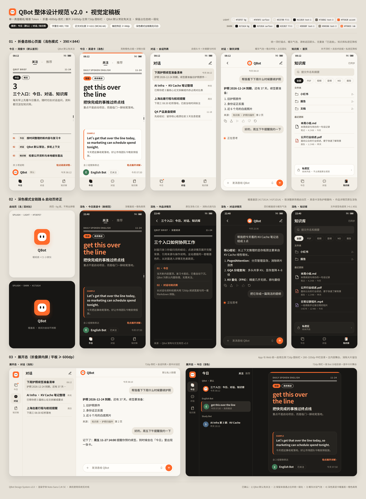

# QBot 设计规范 v2.0

**结论**：QBot 是一张温润的奶白色纸（深色为暖墨色），墨色承担结构与主操作，活力橙 `#FF6A2B` 只做「那个点」。三个 Tab（**今日 / 对话 / 知识库**），默认进「今日」；`QBot` 本身是默认内置私人助理，无需关注。折叠（`< 600dp`）用底部 `56dp` 栏，展开（`≥ 600dp`）统一换左侧 `72dp` 图标栏，一套单一真值 Token 贯穿全端。

配套：代码架构见 [`docs/ARCHITECTURE.md`](ARCHITECTURE.md)，协作与验收见根目录 [`README.md`](../README.md)。

---

## 1. 原则与品牌

1. **克制用色**：大面积奶白/暖墨 + 墨色；活力橙 `#FF6A2B` 只用于品牌图标、发送键、未读点、选中图形点缀与焦点环（单屏不超过 2 处，不做整屏亮橙启动页或深色刺眼亮橙卡）。
2. **主次分明**：真实可用操作保持清晰墨色/活力橙对比；未接通占位能力（语音、朗读、本地附件、赞/踩、私密区）保留入口位置但统一弱化降权，不抢主视觉。
3. **一套语言，三个场景**：「今日」「对话」「知识库」共用同一套语义色、字号、顶栏基线、空态与错误态。
4. **双形态一致**：App 与 Web 遵守同一套折叠/展开布局规则与 `720dp` 阅读宽度上限。

### 品牌与文案
- 统一命名 **`QBot`**（不再混用 `Qbot`）。
- 图标为 **C1「小家伙」**（活力橙底 `#FF6A2B` + 白脸 + 墨眼 `#1C1B19`），源文件在 `apps/qbot-app/assets/brand/`，头像提供 `@1x 48px / @2x 96px / @3x 144px` 高清资源。
- 启动页背景跟随 `--bg`（浅 `#F3EFE7` / 深 `#171614`），居中放 C1 图标。
- 语气用「你」不用「您」，不用感叹号、不卖萌；时间格式统一为 `今天 HH:mm / 昨天 HH:mm / 周X / MM-DD`。

---

## 2. 单一真值 Design Tokens

App（`apps/qbot-app/src/theme.ts`）与 Web（`apps/drive-web/tokens.css`）共用一套暖纸/暖墨语义色阶，所有正文与辅助字对比度均满足 WCAG AA（≥ 4.5:1）：

| 角色 | CSS Token | Native Key | 浅色 Light | 深色 Dark |
|---|---|---|---|---|
| 全局底 / 导航栏 / 启动页 | `--bg` | `canvas` | `#F3EFE7` | `#171614` |
| 页面内容画布 | `--surface` | `bg` | `#FAF8F3` | `#1F1D1A` |
| 抬起表面（卡片 / 输入框 / 弹层） | `--surface-raised` | `raised` | `#FFFEFB` | `#262420` |
| 柔和填充（选中行 / 用户气泡 / 标签底） | `--fill` | `selected / bubbleMe` | `#ECE7DD` | `#2E2B27` |
| 分隔线 / 描边 | `--line` | `line` | `#E3DDD1` | `#34312C` |
| 主文字 / 标题 | `--text-1` | `text` | `#1C1B19`（16.2:1） | `#EDE8DF`（13.8:1） |
| 次要正文 / 常规图标 | `--text-2` | `text2` | `#5C574E`（6.8:1） | `#ABA498`（6.8:1） |
| 辅助信息 / 时间 / 占位符 | `--text-3` | `muted` | `#736D62`（4.8:1） | `#9A9386`（5.5:1） |
| 活力橙（仅图形与关键点） | `--accent` | `accent` | `#FF6A2B` | `#FF6A2B` |
| 橙色文字 / 链接 | `--accent-ink` | `accentInk` | `#C24410`（4.7:1） | `#FF8A55`（6.4:1） |
| 主按钮底 / 字 | `--btn-primary-*` | `btnPrimaryBg/Fg` | `#1C1B19` / `#F3EFE7` | `#EDE8DF` / `#171614` |

### 字体、字重与间距
- Web 字体栈：`"Microsoft YaHei","PingFang SC","Noto Sans SC",system-ui,sans-serif`；Android 原生使用系统默认无衬线，不混用衬线体。
- 全端严格只使用 **`400`（常规）与 `700`（粗体）** 两档字重。
- 字号（px / 行高）：`12/16` 说明与底栏 · `13/20` 元信息 · `15/24` 正文 · `16/26` 对话与阅读 · `17/24` 小标题 · `20/28` 页标题 · `26/34` 大标题 · `36/42` 主视觉短语。
- 间距为 4 的倍数；所有可交互元素有效触控热区 **`≥ 44×44dp`**（小胶囊按钮使用 `hitSlop` 补足）。
- 思考态动效：QBot `8dp` 活力橙圆点慢呼吸（2.4s 循环），不使用外部品牌符号（如 `✻`）。

---

## 3. 导航与双形态布局

- **顺序与默认项**：**今日（默认）/ 对话 / 知识库**，使用 `design/tabbar-v1/icons/a/` 方向 A 图标（未选 `--text-3` 线，选中 `--text-1` 墨色填充 + 唯一一处 `#FF6A2B`；文字不用橙色）。
- **折叠态（`< 600dp`）**：底部 `56dp` 导航栏 + 安全区留白（不画横条），顶边 `1px --line`。进入二级页面（对话内、作品详情、知识库文件详情）或弹出软键盘时隐藏。
- **展开态（`≥ 600dp`）**：左侧常驻 `72dp` 图标栏（顶部 `34dp` C1 标 + 3 个 `56×56dp` 圆角 `14dp` 图标项，选中态 `--fill` 底）；中栏 `280–400dp` 列表/目录；右侧主内容区（对话与阅读宽 `≤ 720dp`，今日卡片居中舞台 `≤ 420dp`）。

---

## 4. 三大 Tab 规范

### 4.1 今日
- 顶部悬浮切换条「关注 · 推荐」（默认「关注」），带选中指示线；右侧多卡时显示 `4dp` 竖向进度点。
- 支持原生跟手竖滑分页；切 Tab 严格保留当前 `scope` 与卡片索引，不清空闪屏重刷。
- **`QBot` 为默认内置 Bot，无需关注**：署名行显示 `QBot` + 轻量「默认」标识，不放关注/取关按钮；其他 Bot 保留「关注 / 已关注」按钮（`44dp` 热区），取消关注后提供 3.5 秒「撤销」Toast。
- **深色模式全链路适配**：
  - 品牌橙色卡（如英语卡）在浅色模式使用暖纸底 `#FAF8F3` + 顶部 `4dp` `#FF6A2B` 彩条 + `#FFFEFB` 例句卡（左 `3.5dp` 橙边）；深色模式切换为深暖墨底 `#1F1D1A` + 顶部 `4dp` `#FF6A2B` 彩条 + `#FF8A55` 主短语 + `#262420` 例句卡。
  - 作品详情页（`CardWork`）在深色模式下注入暖墨深色样式，彻底消除从深色封面点进详情闪白。
- 封面底部增加轻量「轻点阅读详情 ›」引导，与详情页形成「结论预览 → 深度展开」分层。

### 4.2 对话
- **会话列表**：顶栏 `52dp`（左「对话」20px Bold，右「新建对话」笔图标）；移除不能点击的静态头卡与每行重复的「已连接」标签；仅在异常/同步中显示轻量状态条；会话行高 `68dp`，展示标题 + 时间 + 摘要预览。
- **对话详情**：顶栏 `52dp`（折叠态左返回箭头 `‹`，中 `28dp` C1 头像 + `QBot`，右新建对话）；用户气泡用柔和暖灰 `--fill`（浅 `#ECE7DD` / 深 `#2E2B27`）+ `--text-1` 墨字；助手回复无气泡全宽 Markdown 排版。
- **操作条与输入区**：复制 / 分享 / 重试保持清晰 `--text-2`；未接通占位（朗读、赞/踩、输入区 `+` 附件与麦克风）保留位置但统一弱化降权；发送文字后不强收键盘，支持连续追问并保留生成中排队发送（立即发送 / 不发了）。

### 4.3 知识库
- 折叠态补齐「知识库」页标题与「已同步」轻提示，与「对话」顶部视觉基线一致。
- 文件夹仅显示友好中文名（去掉 `xhs ·` / `reports ·` 英文路径前缀）。
- 未配置的「私密区」降级为底部轻量细框次级行，不再用全黑重磅卡片霸占首屏主视觉。
- 遵循缓存先行策略，避免冷启动长时间白屏。
