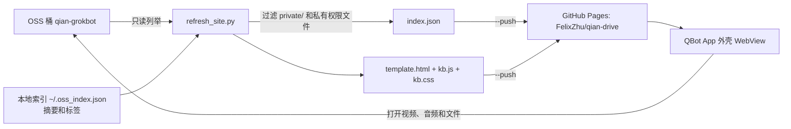

# 知识库 Tab：架构与设计

## 1. 一句话
文件存放在阿里云 OSS 的 `qian-grokbot` 桶（北京区域）。发布脚本只读地列出公开文件，生成 `index.json`；网页里的知识库模块读这个索引，提供文件夹、搜索、标签筛选和详情页。私密文件不会进入网页。

## 2. 数据流

## 3. 代码位置（FelixZhu/QBot，`apps/drive-web/`）
| 文件 | 作用 |
|---|---|
| `refresh_site.py` | 列出 OSS 文件，排除 `_site/`、`trash/`、`_test/`、`private/` 和私有权限对象，再生成 `index.json` 和网页，`--push` 时发布 |
| `kb.js` | 知识库模块，挂载在 `#tab-kb` 上，没有任何依赖 |
| `kb.css` | 知识库样式，只使用设计 token（`--sp-*`、`--r-*`、`--ft-*` 等），自动适配深色模式 |
| `sample-index.json` | 脱敏的示例数据，用于本地预览和截图 |
| `live_check.py` | 检查线上页面 |

## 4. index.json 字段
`key`（OSS 路径）、`name`、`kind`（video/audio/pdf/…）、`doc_type`（中文类型）、`size`、`mtime`、`dir`、`summary`、`tags`、`private`（目前始终为 false）。顶层有 `base`（公开访问地址前缀）和 `count`。

## 5. 模块状态与交互
状态：`q`（搜索词）、`chips`（选中的标签，多个标签同时满足才显示）、`folder`（当前文件夹）、`selected`（当前文件）、`openFolders`（目录树的展开状态）。

| 场景 | 折叠（<600px） | 展开（≥600px，如 840） |
|---|---|---|
| 首页 | 顶部是搜索、标签和私密区入口，下面是文件夹和最近更新 | 左栏是搜索、标签、私密区和目录树，右栏是最近更新 |
| 详情 | 占满整屏，顶部有「‹ 返回」，视频和音频直接在页面里播放 | 右栏显示详情，左栏目录高亮当前文件 |
| 目录树 | 不显示 | 点名称进入文件夹，点箭头展开或收起 |

返回键约定：外壳先调用 `window.qbotKb.back()`。处理顺序是关闭弹层、退出详情、回到上级文件夹，返回 `true` 表示已经处理；已经在首页时返回 `false`，由外壳切换 Tab。
其他约定：切换 Tab 或 App 进入后台时自动暂停播放；点击文件时派发 `kb:open` 事件，外壳可以接管。
文件夹显示：长度 8 位以上的哈希目录名会被隐藏；常用目录显示中文名（报告、视频、B站视频、小宇宙播客、小红书、文档），和 Feed 卡片上的名称一致。

## 6. 隐私与安全
- 桶是公共读，但 `private/` 下的文件都设置为私有权限，网页和索引里都不会出现。
- 私密文件只能通过临时签名链接访问（最长 7 天），链接只私信发给 Qian，不写进仓库、记忆或 skill。
- 私密区入口目前显示「尚未配置」。下一步需要 Qian 创建只读 RAM 子账号，再和 IM 工程师确定解锁方式（例如设备指纹或口令），然后按需生成签名链接查看文件。
- 仓库是公开的，不提交密钥或有版权的字体；密钥只从环境变量读取，不打印。

## 7. 后续
1. 私密区查看流程（等 RAM 子账号）。
2. 全文检索：给 PDF 和文档抽取文本并生成摘要，写进索引的 `summary`，以后可以扩展成片段级检索。
3. 新文件入库后自动刷新索引，和主动服务的「新文件入库提醒」共用一个触发器。
