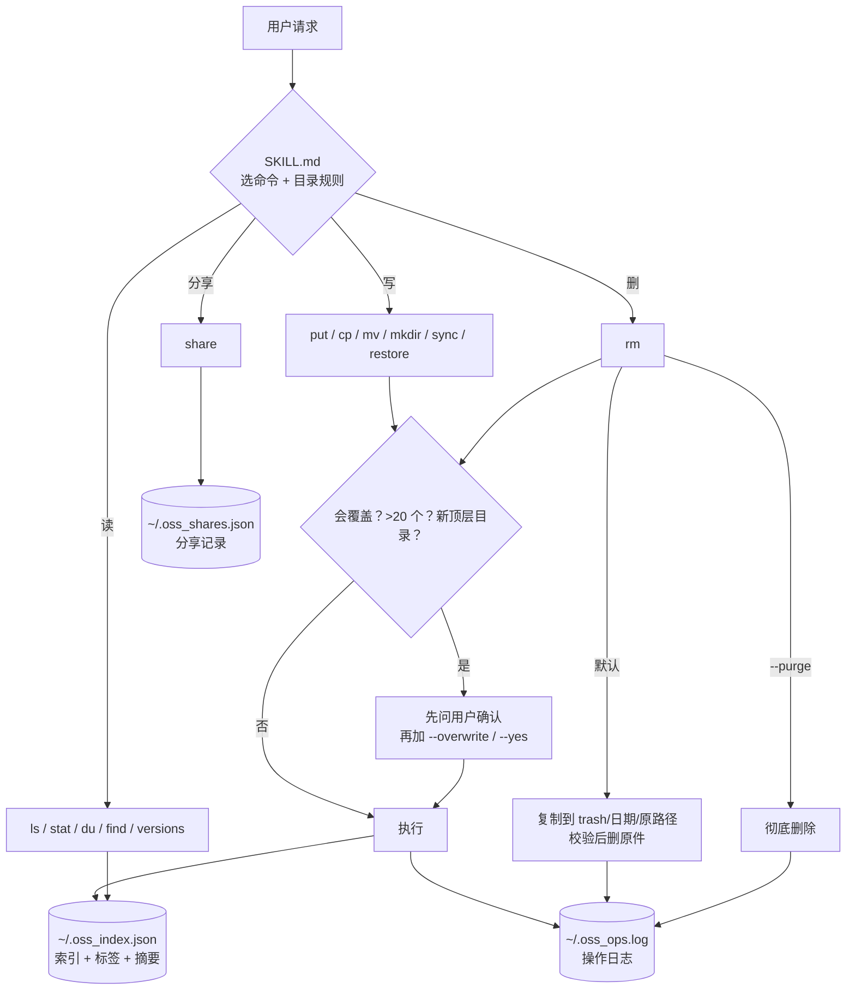

# aliyun-oss-drive · 阿里云 OSS 网盘

把 Qian 的阿里云 OSS bucket `qian-grokbot` 当成一个 Dropbox 式网盘来用。它能浏览、上传、下载、整理、删除、搜索、分享和同步文件，删掉的文件先进回收站。它取代了只会上传和签链接的旧 skill `aliyun-oss-upload`。

## 做什么
| 能力 | 说明 |
|---|---|
| 浏览 | `ls` 列目录（可递归，可按大小或时间排序），`stat` 看单个文件，`du` 按目录统计占用 |
| 上传 | `put` 传单个文件或整个文件夹，大文件断点续传，默认不覆盖 |
| 下载 | `get` 下载单个文件或整个目录，断点续传，默认不覆盖本地文件 |
| 整理 | `cp`、`mv`（含改名）、`mkdir`，对单个文件和整个目录都适用 |
| 回收站 | `rm` 移到 `trash/<日期>/<原路径>`；`trash ls`、`trash restore`、`trash empty`；`--purge` 彻底删除 |
| 搜索 | `find` 按文件名关键词、目录、扩展名、时间、大小过滤；`--tag` 和 `--text` 查本地索引里的标签和摘要 |
| 分享 | `share` 生成限时签名链接（最长 7 天），`share ls` 查看发过的链接是否过期 |
| 同步 | `sync` 让本地文件夹和 OSS 目录单向或双向同步，只传有变化的文件，支持 `--dry-run` |
| 历史版本 | `versions`、`restore-version`；bucket 没开版本控制时会明确提示 |

**触发场景**：用户说"存到 OSS / 网盘""帮我找那个文件""给我个下载链接""删掉/恢复""把这个文件夹同步上去"，或者其他任务产出的文件需要归档。

## 设计

关键取舍：
- **一个脚本，多个子命令**：所有能力都在 `oss.py` 里，用法和 `git`、`aws s3` 一样直观，也方便 bot 按退出码判断下一步。
- **安全默认值**：上传、下载、复制、移动、恢复都默认不覆盖；`rm` 默认进回收站；一次超过 20 个对象、彻底删除、清空回收站都要显式参数。脚本拒绝时用专门的退出码（4 是已存在，5 是需确认），bot 拿到后去问用户，不会自己加参数绕过。
- **移动 = 复制 + 校验 + 删除**：OSS 没有原生的 rename。脚本先复制，再核对目标的大小和 ETag，一致了才删原件；校验失败就保留原件。回收站和恢复也走同一条路径。
- **回收站就是一个前缀**：`trash/<YYYY-MM-DD>/<原 key>` 不需要额外的元数据，看路径就知道哪天删的、原来在哪。同一天重复删同一个文件时，目录名会加上 `_HHMMSS`，不会覆盖之前的回收站副本。
- **本地索引补齐"按内容找"**：OSS 只能按前缀列，没法全文检索。所以在本地维护 `~/.oss_index.json`，记录 key、大小、时间，以及 bot 或用户加的标签和一句话摘要。每次写操作自动更新索引，移动文件时标签会跟着走；也可以随时 `index rebuild`。
- **私有访问 + 签名链接**：分享只用签名链接，最长 7 天，过期后重新签发。分享记录只存 key 和过期时间，不存链接本身。
- **同步保守**：同步只看大小和修改时间来判断是否有变化。上传时把本地 mtime 写进对象元数据 `x-oss-meta-mtime`，下载后把本地文件的 mtime 设成同一个值，这样下次比较时两边一致，不会来回重传。双向同步按"新的覆盖旧的"处理，判断不出新旧时列为冲突，不动。`--delete` 只能配单向同步使用；删远端时进回收站。

## 技术实现
| 文件 | 作用 |
|---|---|
| `SKILL.md` | 给 bot 读的说明：配置、目录规则、命令速查、流程、确认规则 |
| `oss.py` | 命令行实现（Python 3 + 阿里云官方 SDK `oss2`） |
| `README.md` | 本介绍 |

`oss.py` 要点：
- **连接**：`oss2.Auth(OSS_ACCESS_KEY_ID, OSS_ACCESS_KEY_SECRET)` 加上 `oss2.Bucket(endpoint, bucket, connect_timeout=600)`。endpoint 和 bucket 可以用 `OSS_ENDPOINT`、`OSS_BUCKET` 覆盖。凭证只从环境变量读，不进日志、索引或输出。
- **列举**：用 `oss2.ObjectIterator` 列举，非递归时设 `delimiter="/"` 得到子目录。`du` 和 `find` 递归列举后在本地做过滤和汇总。
- **上传**：`oss2.resumable_upload`，超过 4 MB 走分片，每片 4 MB，3 个线程，断点记录放在 `~/.oss_resume`。外层最多重试 8 次，退避 5 到 30 秒，只对网络错误、5xx、408 和 429 重试。
- **下载**：`oss2.resumable_download` 用同样的分片、线程和断点目录，下载完把本地 mtime 设成远端的 mtime。
- **复制**：1 GB 以内用 `copy_object`，元数据原样保留；更大的文件用 `init_multipart_upload` 加 `upload_part_copy`（每片 100 MB）做服务端分片复制。复制完 `head_object` 校验。
- **删除**：`--purge` 用 `batch_delete_objects`，每批 1000 个。
- **分享**：`bucket.sign_url("GET", key, 秒数, slash_safe=True)`，天数限制在 1 到 7 天。
- **版本**：先用 `get_bucket_versioning` 查状态，没开就以退出码 6 明确报错；开了就用 `list_object_versions` 列出版本和删除标记，用带 `versionId` 的 `copy_object` 恢复旧版本（旧版本会作为新的最新版本写回）。
- **状态文件**：索引和分享记录用 `fcntl` 文件锁加原子替换写入，权限 600，多个 bot 同时写也不会写坏。`~/.oss_ops.log` 每行一条 JSON，记录时间、操作、bucket、对象数和前 50 个 key，没有任何凭证。
- **输出**：`ls`、`stat`、`du`、`find`、`share`、`trash ls`、`versions` 支持 `--json`；时间按本机时区显示。

## 使用示例
```bash
O="python3 oss.py"
$O ls xhs/ --sort time                       # 看小红书目录，最新在前
$O du                                        # 各目录占用
$O put ./report.pdf reports/                 # 上传到 reports/report.pdf
$O put ./trip-photos docs/trip-2026/         # 上传整个文件夹
$O find 发布会 --ext mp4 --since 2026-10-01   # 找 10 月以来的 mp4
$O tag videos/bilibili/a.mp4 发布会 --summary "B站某发布会全程录像"
$O find --text 发布会 录像                    # 按标签/摘要找
$O share videos/bilibili/a.mp4 --days 3      # 3 天下载链接
$O mv docs/old-name.pdf docs/new-name.pdf    # 改名
$O rm docs/tmp/                              # 整个目录进回收站
$O trash restore docs/tmp/                   # 恢复
$O sync ./notes docs/notes --dry-run         # 先看同步计划
```

## 测试
2026-11-16 在真实 bucket 的临时前缀 `_test/drive-<时间戳>/` 下逐个测过全部子命令，包括覆盖保护、超过 20 个的批量确认、9 MB 分片上传和下载的逐字节比对、目录复制和移动、回收站的删除、恢复和清空、标签搜索、签名链接实际下载，以及同步的上传、下载、双向和 `--delete`。测完已彻底删除这个前缀和它在回收站里的副本，bucket 回到测试前的 19 个对象。

## 已知限制
- 签名链接最长 7 天，不能当永久链接。
- 签名链接只有在 bucket ACL 为私有时才真正起到访问控制作用，请确保 bucket 和对象都是私有读写；脚本不会自己改 bucket 设置。
- 回收站不会自动清理，需要定期运行 `trash empty --older-than 30`（也可以在控制台给 `trash/` 配生命周期规则）。
- 版本控制目前没开，`versions` 和 `restore-version` 要在阿里云控制台开启后才有用；开启后旧版本也会占用存储。
- 按内容搜索只覆盖本地索引里有标签或摘要的文件；索引是本机文件，换机器需要重新 `index rebuild`，标签不会跟着走。
- 同步只比较大小和修改时间，不比较文件内容哈希，也不处理空目录。
- 超过 1 GB 的服务端分片复制已经实现，但只用小文件测过。
- 依赖共享电脑上设置好的 OSS 环境变量。早期 AccessKey 曾在聊天里明文出现，建议轮换，并改用只授权这个 bucket 的 RAM 子账号密钥。
