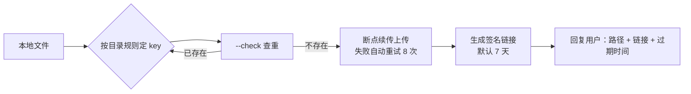

# aliyun-oss-upload · 阿里云 OSS 归档上传

把整理好的文件（视频、PDF、报告、飞书导出等）按统一的目录规则上传到 Qian 的阿里云 OSS bucket `qian-grokbot`，并返回一个限时下载链接。所有 bot 共用这一套规则，避免各存各的。

## 做什么
- **使用场景**：bot 下载或生成了文件，需要让 Qian 在手机或电脑上拿到；或者要把资料长期归档。
- **触发**：用户说"存到 OSS""传到阿里云""给我个下载链接"，或其他 skill（比如 `xiaohongshu-download`）产出文件后需要分享。
- **输入**：本地文件路径，加上按目录规则确定的对象 key。
- **输出**：`oss://qian-grokbot/<key>`、文件大小、签名下载链接及过期时间。

## 设计

关键取舍：
- **统一目录规则**：`xhs/`、`videos/<平台>/`、`feishu/`、`docs/`、`reports/`、`intake/<YYYY-MM>/`。这些都是从 Grok Bot、Lark Bot、Info Bot 过去的实际用法里总结出来的。新类别要先问用户，不让 bot 随意新建顶层目录。
- **私有 bucket 加签名链接**：bucket 开了"阻止公共访问"，不走公共读，每次分享都签发临时链接（最长 7 天），过期后用 `--sign` 重新签名。
- **不覆盖**：同一个 key 已存在就拒绝上传，防止误删旧资料。
- **凭证只走环境变量**：密钥不进文件、不进聊天、不进仓库。缺失时用安全卡片向用户索取。
- **大文件稳定性**：沙箱网络到北京区较慢，所以用小分片加断点续传缓存，失败后从断点接着传。

## 技术实现
| 文件 | 作用 |
|---|---|
| `SKILL.md` | 给 bot 读的操作说明：固定配置、目录规则、步骤和注意事项 |
| `oss_upload.py` | 上传、查重和重新签名的命令行脚本 |
| `README.md` | 本介绍 |

`oss_upload.py` 的要点：
- 依赖 Python 阿里云官方 SDK [`oss2`](https://pypi.org/project/oss2/)（`pip install oss2`）。
- 连接：`oss2.Auth(OSS_ACCESS_KEY_ID, OSS_ACCESS_KEY_SECRET)` 加上 `oss2.Bucket(endpoint, "qian-grokbot", connect_timeout=600)`。endpoint 和 bucket 可用环境变量 `OSS_ENDPOINT`、`OSS_BUCKET` 覆盖。
- 上传：`oss2.resumable_upload`，分片 4 MB，3 个线程，断点缓存放在 `~/.oss_resume`。外层最多重试 8 次，每次退避 5 到 30 秒。
- 查重：上传前先调用 `bucket.object_exists(key)`；`--check` 只做这一步。
- 签名：`bucket.sign_url("GET", key, 秒数, slash_safe=True)`，天数限制在 1 到 7 天，同时打印本地时区的过期时间。

## 使用示例
```bash
# 上传一份报告
python3 oss_upload.py ./douyin-report.pdf reports/douyin-ecom-ecosystem-report.pdf

# 先查重
python3 oss_upload.py ./a.mp4 videos/bilibili/a.mp4 --check

# 链接过期了，重新签一个 3 天的
python3 oss_upload.py --sign intake/2026-11/US_Ecom_Monthly_202610.pdf --days 3
```

## 已知限制
- 签名链接最长 7 天，不能当永久链接存档。
- 依赖共享电脑上已经设置好的 OSS 环境变量；换机器要重新配置。
- 早期 AccessKey 曾在聊天里明文出现过，建议在阿里云控制台轮换，并改用只授权这个 bucket 的 RAM 子账号密钥。
