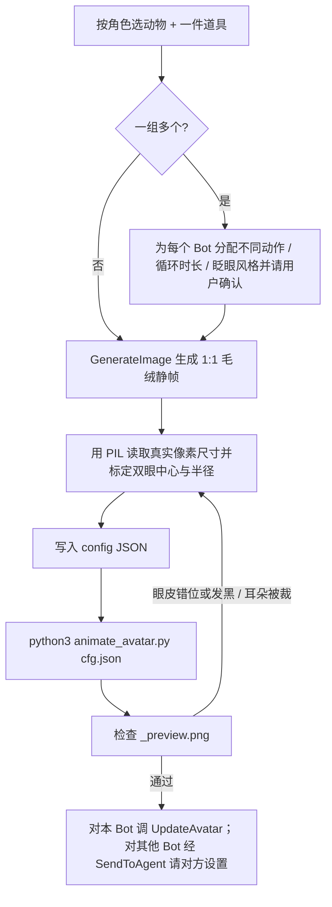

# cute-animated-avatar

为 Bot 制作毛绒风格、适合圆形裁切的循环 GIF 头像：偶尔眨眼，再加一个标志性动作。

## 做什么

当用户要给本 Bot 或其他 Bot 换（动态）头像时使用。流程是：先设计一只毛绒角色，生成正面静帧，再做成循环 GIF。

- **使用场景**：单个 Bot 换头像，或给一组相关 Bot 做风格统一、动作各异的头像家族。
- **触发方式**：用户明确提出要新的（动态）头像 / 头像 GIF。
- **输入**：Bot 的角色定位；可选参考图；若是一组 Bot，还要为每个角色选定动作和眨眼节奏。
- **输出**：约 200×200、10 fps、约 96 色的循环 GIF（建议小于约 2 MB），以及一张 `_preview.png`（首帧 + 各眨眼帧，圆形蒙版）。对本 Bot 可直接设置头像；对其他 Bot 只能请对方自行设置。

本目录只有 `SKILL.md`。动画脚本 `animate_avatar.py` 写在该文件里，使用时再保存到例如 `/workspace/avatars`。

## 设计

核心思路是「先出一张可复用的毛绒静帧，再用确定性脚本做眨眼和动作」，而不是直接生成整段动画。这样同一张静帧可以精确控制眨眼时机、眼皮颜色和循环动作，一组 Bot 也更容易保持画风一致。

关键取舍和约束：

- 角色正面、头和上半身居中，约占画面 80%，纯暖奶油色背景，眼睛必须睁开，无文字。一组 Bot 要把已有头像作为 `reference_image_paths`，以锁定风格。
- 每个角色加一件能体现职责的道具（例如消息类用纸飞机、新闻类用报纸、创作类用画笔）。若用户给了参考图，以参考图的角色为准。
- 一组头像的动作必须不同，可选 `sway` / `hop` / `tilt` / `groove`；循环 4–12 秒；眨眼可以是快/慢、连眨，或单眼 wink。做一组之前先写计划并得到用户同意。
- `GenerateImage` 即使指定 1:1，实际输出经常是 1280×720。测量眼睛坐标前必须用 PIL 读真实宽高；如果预览里显示宽度是 1024，要把显示坐标乘以 `width/1024` 换算成源图像素。
- 默认按图像高度做居中正方形裁切；只有道具在侧边会被切掉时，才把 `crop_w` 设成大于 720。
- 圆形构图里，`scale` 常用 0.87：耳朵被圆裁切就调低，头顶空太多就调高。
- 头像上传对文件体积敏感，GIF 要控制在约 2 MB 以内（默认 200 px、96 色、10 fps）。更大的文件曾经上传失败。
- 本 Bot 用 `UpdateAvatar`（`set` + GIF 路径）设置；不能直接改其他 Bot 的头像，只能用 `SendToAgent`（`priority: true`）请对方用同样的盒子路径调用 `UpdateAvatar`，等对方确认后再告诉用户。
- 为避免 hop / tilt 时露出底部裁切边，脚本会把底部若干行向下拉伸并轻微模糊。

## 技术实现

### 用到的工具

- **GenerateImage**：生成 1:1 毛绒静帧，可用 `reference_image_paths` 保持系列风格。
- **PIL（Pillow）**：`Image`、`ImageDraw`、`ImageFilter`、`ImageChops`。负责读尺寸、取色、眨眼合成、旋转缩放、调色板量化、写 GIF 和预览图。
- **UpdateAvatar / SendToAgent**：应用头像。
- 运行方式：`python3 animate_avatar.py config.json`。

### 文件结构

| 文件 | 作用 |
|---|---|
| `SKILL.md` | 技能说明，以及完整的 `animate_avatar.py` 源码。目录里没有单独的脚本文件。 |

### 配置字段（单位都是源图真实像素）

| 字段 | 含义 |
|---|---|
| `src` / `out` | 源图路径、输出 GIF 路径 |
| `eyes` | `[[x, y], [x, y]]` 左右眼中心 |
| `r` | 眼睛半径（覆盖虹膜和眼白） |
| `crop_w` | 居中裁切宽度，需 ≥ 图像高度；侧边有道具时再加宽 |
| `scale` | 角色在画幅中的占比，典型值 0.87 |
| `lid_up` | 从眼顶再往上多少像素取样眼皮毛色；眼皮发黑就加大，或增大 `r` |
| `motion` | `sway`、`hop`、`tilt`、`groove` 之一 |
| `loop_s` | 循环时长（秒），同时也是眨眼周期 |
| `blinks` | `[frame_index, "both"\|"left"\|"right", "fast"\|"slow"]` 列表；按 10 fps，帧号 = 秒 × 10 |
| `amp` | 可选，动作幅度倍率，默认 1 |
| `size` | 输出边长，默认 200 |

### 动画实现要点

- 帧数 `N = loop_s * 10`，每帧 100 ms，`loop=0` 无限循环。
- 眼皮颜色：在眼顶上方 `lid_up`（默认 18）处对 9×9 邻域取平均，作为眼皮毛色。闭合接近完成时再画一笔深色弧线当睫毛。
- 眨眼曲线：`fast` 为两帧（全闭 → 半开），`slow` 为四帧（1 → 0.85 → 0.6 → 0.3）。
- 四种动作（均可乘 `amp`）：
  - `sway`：约 4 秒周期的左右轻摆，并带 2 秒周期的上下微动。
  - `hop`：1 秒一次跳跃，落地时挤压（`sy` 减小、`sx` 增大）。
  - `tilt`：每个循环左右各做一次「倾斜并停住」。
  - `groove`：约 1.5 秒周期的节奏摇摆，接近结尾再跳一下。
- 调色：以中间帧做 96 色 `MEDIANCUT` 调色板，其余帧用该调色板 + `FLOYDSTEINBERG` 抖动，控制体积。
- 预览图把首帧和每个眨眼帧拼成一条，并套圆形蒙版，便于检查眼皮是否对位。

### 依赖与环境

需要能调用 `GenerateImage`、`UpdateAvatar` 的运行环境，以及 Python 3 + Pillow。脚本本身无网络依赖。

## 使用示例

用户：「给这个 Bot 做一个毛绒头像 GIF，风格可爱一点。」

1. 按职责选角色和道具，必要时先给方案请用户确认。
2. 用指定提示词生成静帧，PIL 核对真实尺寸。
3. 标定眼睛，写出 `cfg.json`，运行 `python3 animate_avatar.py cfg.json`。
4. 看 `_preview.png`：眼皮错位多半是坐标缩放错了；眼皮发黑就提高 `lid_up` 或增大 `r`。
5. 通过后设置头像，并在对话里把 GIF 给用户看。

## 已知限制 / 注意事项

- 必须先确认源图真实像素，不能按预览画布的 1024 宽度直接量。
- 输出体积要压在约 2 MB 以内，否则头像上传可能失败。
- 不能直接修改其他 Bot 的头像。
- 源图需要纯色背景、角色居中、身体延伸到画面底部，脚本才按「底部贴边」来构图。
