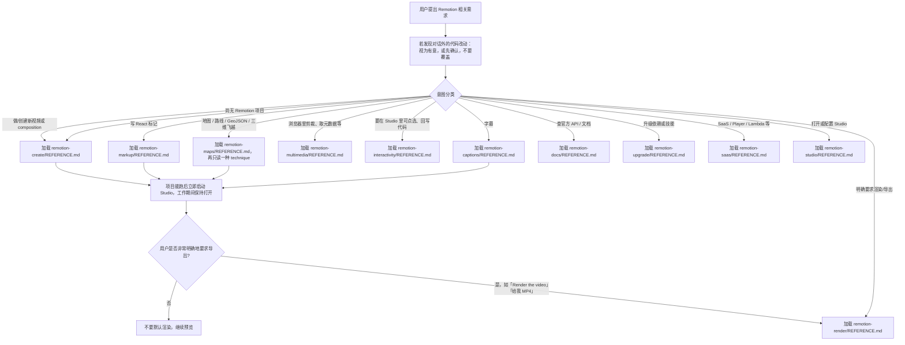

# remotion-best-practices

所有 Remotion 技能的路由器：根据用户当前任务，加载对应的子技能文档，并规定默认先开 Studio 预览、只有明确要求时才渲染。

## 做什么

- **使用场景**：任何与 Remotion 相关的工作——新建视频、写 React 标记、地图、字幕、导出、查文档、升级、做 SaaS 等。它本身很少单独完成全部工作，而是把代理导向正确的专项说明。
- **触发方式**：用户提到 Remotion / 用代码做视频，或其他 Remotion 子技能在收尾时要求「回到 Best Practices」。官方描述是 “Router for all Remotion skills”。
- **输入**：用户的具体意图（做新视频、改画面、导出、加字幕等）和当前项目状态。
- **输出**：加载并执行对应子技能后的项目改动、Studio 预览或（在明确要求时）导出文件。

技能版本标注为 `4.0.534`。本目录内嵌了一整套子技能（多数以 `REFERENCE.md` 为入口），其中 captions / create / markup / render / studio 与仓库顶层的同名技能对应；docs、interactivity、maps、multimedia、saas、upgrade 则只作为本路由的子技能出现。

## 设计

这是一份「按意图分发 + 保护用户改动 + 预览优先」的总则，而不是又一份 API 大全。子技能目录彼此独立，用哪个就加载哪个，避免一次把全部文档读进上下文。



关键取舍和约束：

- **保留用户改动**：用户可能在对话之外改代码。若发现意外变化，不要覆盖，默认当作有意修改，或先确认。
- **先预览，后渲染**：用户说 make / create 一类的话，默认要的是可交互预览，而不是导出。Studio 里也有更直观的渲染界面，可以优先用界面而不是命令行。
- **Studio 启动因客户端而异**：
  - Cursor：`npx remotion studio`，不要加 `--no-open`，让系统浏览器自动打开。
  - 带应用内浏览器的其他代理：可用上面的命令，或 `npx remotion studio --no-open`，然后打开打印出的精确 URL，并确认 Studio 以及 composition 预览能加载；打不开就去掉 `--no-open`。
  - 没有应用内浏览器：`npx remotion studio`，已打开则会重新聚焦。
  - 指定 composition：访问 `/[composition-id]`，例如 `http://localhost:3000/MapAnimation`。
  - 技能注明 Studio 支持 WebMCP tools。
- **地图**：先根据镜头类型只选一种 technique（static-map / Mapbox / MapLibre / MapTiler / CesiumJS），只加载该目录的 `TECHNIQUE.md`。各 technique 自包含，删掉其中一个不影响其他。
- **包版本**：安装 `@remotion/*`、`mediabunny`、`@mediabunny/*`、`zod`、`@huggingface/transformers` 时用 `npx remotion add`，以免版本不一致（这条也写在 markup 技能里）。

## 技术实现

### 常用命令

```bash
npx remotion studio
npx remotion studio --no-open
npx remotion render
```

更细的 Studio 参数见 [remotion-studio](../remotion-studio/README.md)，渲染见 [remotion-render](../remotion-render/README.md)。

### 子技能如何被加载

路由入口是本目录的 `SKILL.md`。每个子目录用 `REFERENCE.md`（不是顶层技能那种 `SKILL.md`）作为说明入口。地图类还要再下钻到 `techniques/<name>/TECHNIQUE.md`。

### 文件结构

| 路径 | 作用 |
|---|---|
| `SKILL.md` | 路由规则、预览/渲染策略、保留用户改动。 |
| `agents/openai.yaml` | Agent 界面元数据。 |
| `assets/remotion-icon.svg` | 技能图标。 |
| `remotion-create/` | 脚手架新项目 / 新 composition。与顶层 [remotion-create](../remotion-create/README.md) 对应。 |
| `remotion-markup/` | React 标记、动画、特效等实践。与顶层 [remotion-markup](../remotion-markup/README.md) 对应，内容是一份内嵌拷贝。 |
| `remotion-captions/` | 转写、导入、展示字幕。与顶层 [remotion-captions](../remotion-captions/README.md) 对应。 |
| `remotion-render/` | 导出视频 / 静帧 / 透明成片。与顶层 [remotion-render](../remotion-render/README.md) 对应。 |
| `remotion-studio/` | 启动和配置 Studio。与顶层 [remotion-studio](../remotion-studio/README.md) 对应。 |
| `remotion-docs/` | 用官方文档站点的搜索接口查找文档，并把文档 URL 加上 `.md` 后缀拉取 Markdown 源（节省 token）。不要在对话里复制搜索接口的密钥，密钥只留在 `REFERENCE.md` 里供运行时使用。 |
| `remotion-interactivity/` | 让 Studio 能识别结构：点选、拖放、改样式和关键帧并回写代码。核心是 `Interactive.withSchema({wrapInSequence: true})`，以及特效数组也要内联（`inline-effects.md`）。 |
| `remotion-maps/` | 地图总入口。五种 technique 见下表。 |
| `remotion-multimedia/` | 在浏览器 / Node / Bun 里用 Mediabunny 取音频时长、视频时长和视频宽高。 |
| `remotion-saas/` | 用 Remotion 做应用：选模板（Next.js、Vercel Sandbox、React Router 7、Express 渲染服务）、`<Player>`、以及 Lambda / Vercel / Node / Cloudflare 等渲染途径。也指向 Vue / Angular / Svelte 文档。凭证只放在环境变量（如 `REMOTION_AWS_ACCESS_KEY_ID`），不要让用户把密钥贴进聊天。 |
| `remotion-upgrade/` | 升级 Remotion 及配套包、Mediabunny 相关包和已安装的 Remotion Agent Skills。优先 `npx remotion upgrade`；若没有本地 CLI，再按 `npm view remotion version` 手工对齐版本，并用 `npx skills update ...` 更新技能。 |

#### 地图 techniques（`remotion-maps/techniques/`）

| technique | 适用镜头 | 要点 |
|---|---|---|
| `static-map` | 静态底图 + 其上的动画 | 自行准备卫星图，放进 ``，在图上做动画 |
| `mapbox` | 需要 Mapbox 风格或更高保真 | 需要 Mapbox token（环境变量名 `REMOTION_MAPBOX_TOKEN`）；默认样式更好，远处可显示地球，含埃菲尔铁塔等 3D 建筑 |
| `maplibre` | 不想申请密钥 | 完全免费、无需 API key，不含 3D 建筑 |
| `maptiler` | 地理讲解、沿边界/河流/标注做动画 | 使用 MapTiler；可在地理要素上叠加注释。含示例组件、`tokens.ts`（仅视觉示例 token，需在项目里替换）、以及 `scripts/prep-geo.mjs` |
| `cesium` | 地形/山脉飞越，「飞行模拟」视角 | 城市模式需要 `REMOTION_GOOGLE_MAPS_API_KEY`（Google Map Tiles API）。含 `CesiumFlythrough.tsx`、路径 JSON、`scripts/prep-cesium-path.mjs` |

每种 technique 还可能带 `references/`（渲染稳定性、数据源、架构、排错）和 `assets/` 示例。不要在 README 或对话里写入真实密钥。

#### 多媒体（`remotion-multimedia/`）

- `get-audio-duration.md`：`Input` + `UrlSource`，`computeDuration()`。
- `get-video-duration.md`：同样用 `computeDuration()`。
- `get-video-dimensions.md`：`getPrimaryVideoTrack()` 后读取宽高。

总览也可参考 https://mediabunny.dev/llms.txt。

### 依赖与环境

Node.js、可运行的 Remotion 项目（若还没有，会先走 create）。部分子技能额外需要 GPU（字幕转写）、地图供应商密钥、或云渲染相关的环境变量。升级时要保证所有 `remotion` / `@remotion/*` 使用同一版本。

## 使用示例

用户：「用 Remotion 做一条地图上的路线动画，先让我看看预览。」

1. 按本路由加载 `remotion-create`（若无项目）和 `remotion-maps`。
2. 根据镜头选择 MapLibre（无 key）或 Mapbox / MapTiler（有 key）。
3. 项目能跑后执行 `npx remotion studio`，不要先 `render`。
4. 用户之后如果说「导出 MP4」，再加载 render 技能执行 `npx remotion render`。

用户：「把项目里的 Remotion 升级到最新。」

加载 `remotion-upgrade`：能跑 `npx remotion upgrade` 就用它（同时更新项目内技能）；否则手工对齐版本并更新技能，再检查 lockfile 和 `npx remotion versions`。

## 已知限制 / 注意事项

- 这是路由器，专项细节以各子技能文档为准；顶层仓库里还有一份独立的 captions / create / markup / render / studio，内容与这里的内嵌拷贝对应，改一处时要注意是否需要同步。
- 不要默认渲染，也不要覆盖用户在对话外的修改。
- 地图只加载一种 technique，避免把五种实现一次性读入上下文。
- 查文档时使用官方提供的搜索方式，但不要把接口密钥抄到本 README 或其他对外说明里。
- SaaS / Lambda / 地图相关密钥一律走环境变量，不要出现在聊天或仓库文档的示例值里。
