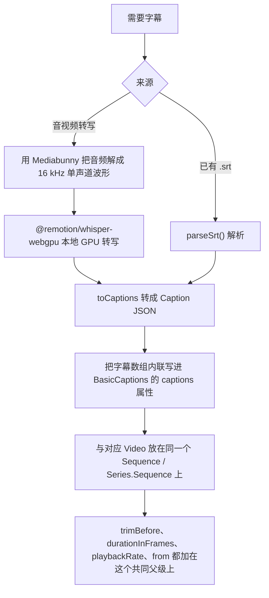

# remotion-captions

为 Remotion 视频转写、导入并展示字幕。所有字幕都先统一成 `@remotion/captions` 的 `Caption` JSON，再放到时间轴上和对应镜头一起剪。

## 做什么

- **使用场景**：给视频或音频自动生成字幕、从 `.srt` 导入字幕，或在画面上做逐词/分页字幕动画。
- **触发方式**：用户提到 captions、字幕、转写、SRT 时，由本技能或 `remotion-best-practices` 加载。
- **输入**：源视频/音频文件，或 `public/` 中的 `.srt`（也支持远程 URL）。
- **输出**：`Caption[]` JSON，以及在 composition 里与镜头同步显示的字幕（默认用 Basic Captions 元件）。

技能版本标注为 `4.0.534`。完成后应加载 Remotion Best Practices；若尚未打开，再打开 Remotion Studio。

## 设计

字幕不直接绑定整条成片时间轴，而是「以源文件为原点，和所属 clip 放在同一个 Sequence 里」。这样裁切、变速、重排镜头时，字幕会一起动，不必重新对齐整条时间码。



关键取舍和约束：

- 统一数据形状是 `Caption`：`text`、`startMs`、`endMs`、`timestampMs`（可空）、`confidence`（可空）、可选 `pageBreakAfter`。
- 每个源文件单独转写。时间戳相对该源文件开头，包括目前已被剪掉的部分。不要加上 composition 的偏移，也不要把多段转写摊平成整片时间码。
- 必须把每段字幕内联在 `<BasicCaptions captions={[...]}>` 里。如果写成 `captions={captions}` 这种变量，Studio 的 Caption 编辑器就找不到可回写的数组字面量。若转写结果在 JSON 文件里，要把内容复制进这个属性。
- `trimBefore` 或 `playbackRate` 如果只加在 `<Video>` 上，旁边的字幕不会继承。这些属性要放在共同的父级 Sequence 上。
- 默认用 Basic Captions 元件（源码从官网拷入项目且保持不变）。只有用户有更具体的样式要求时，才改用其他 Captions Elements。
- `text` 对空白敏感：每个词前面应带上空格。`pageBreakAfter: true` 表示当前页在这条字幕后结束，下一条另起一页。
- 变速时，`durationInFrames` 表示选取的源帧范围，该组在父时间轴上占用 `durationInFrames / playbackRate` 帧；总时长变化时要更新 composition 时长。

## 技术实现

### 转写（`transcribe-captions.md`）

包：`@remotion/whisper-webgpu`、`@huggingface/transformers`、`mediabunny`、`@mediabunny/server`。用 `npx remotion add`（或 bun/yarn/pnpm 对应命令）安装，以保证版本一致。

Node.js 流程概要：

1. `registerMediabunnyServer()`。
2. `canUseWhisperWebGpu()`，不支持就抛出 `detailedReason`。
3. 用 Mediabunny `Conversion` 丢掉视频，把主音轨转成 `pcm-f32`、单声道、采样率为 `WHISPER_WEBGPU_SAMPLE_RATE`（16 kHz），按 chunk 拼成完整 `Float32Array`。
4. `downloadWhisperModel` + `loadWhisperModel`；默认英文模型 `small.en`。
5. `transcribe({ channelWaveform, model })`，再 `toCaptions()`，把 JSON 写到文件（示例文件名 `captions123.json`）。

模型选择：英文默认 `small.en`；其他语言用多语言模型（如 `small`），并给 `transcribe()` 传 `language`——不支持自动语种检测。全部型号见 `getAvailableModels()`。

浏览器里不用 Mediabunny，改用 `resampleTo16Khz({ file })` 从 `File` 得到波形，其余步骤相同。

硬性环境：需要兼容的 GPU。ONNX Runtime 在 Linux arm64 上不可用。

### 展示（`display-captions.md`）

```bash
npx remotion add @remotion/captions
```

从 https://www.remotion.dev/elements/captions/basic-captions.md 获取 `basic-captions.tsx`，原样拷进项目。其他样式见 https://www.remotion.dev/elements/captions。

示例中，1920 宽的画幅里字幕区域宽 900px，用 `translate: "510px 0px"` 居中（`(1920 - 900) / 2 = 510`），并放在距底部 120px 的位置。`<Video>` 来自 `@remotion/media`。

### 导入 SRT（`import-srt-captions.md`）

`parseSrt({ input: text })` 来自 `@remotion/captions`。用 `staticFile("subtitles.srt")` 或远程 URL 做 `fetch`，解析期间用 `useDelayRender()` / `continueRender` / `cancelRender` 卡住渲染，避免字幕还没加载就出帧。解析后即是 `Caption` 格式，可交给所有 `@remotion/captions` 工具使用。

### 文件结构

| 文件 | 作用 |
|---|---|
| `SKILL.md` | `Caption` 类型定义，以及转写 / 展示 / 导入三条路径的入口。 |
| `transcribe-captions.md` | 用 Whisper WebGPU 在 Node 或浏览器里转写的完整步骤。 |
| `display-captions.md` | 安装 Basic Captions、与镜头共序列、内联字幕数组。 |
| `import-srt-captions.md` | 用 `parseSrt()` 读取本地或远程 `.srt`。 |
| `agents/openai.yaml` | Agent 界面元数据。 |
| `assets/remotion-icon.svg` | 技能图标。 |

### 依赖与环境

- Node 转写：兼容 GPU、非 Linux arm64（就 ONNX Runtime 而言），以及上述 npm 包。
- 展示与 SRT：`@remotion/captions`，展示时通常还要 `@remotion/media`。
- 浏览器转写需要 WebGPU。

## 使用示例

用户：「给 opening.mp4 自动加字幕。」

1. 安装 whisper-webgpu 相关包，写脚本把 `public/opening.mp4` 转成 `Caption[]`。
2. 把 JSON 内容内联进该镜头 `Series.Sequence` 里的 `<BasicCaptions>`。
3. 把这段视频已有的 `trimBefore` / `durationInFrames` 挪到这个共同的 Sequence 上。
4. 打开 Studio，检查字幕和画面是否一起入出点。

若已有 `public/subtitles.srt`，则用 `parseSrt()` 导入后再按同样方式内联（若要在 Studio 里编辑字幕，仍需把数组写进 JSX，而不是只在运行时 fetch）。

## 已知限制 / 注意事项

- Linux arm64 不能走这套 ONNX / Whisper WebGPU 转写。
- 非英语必须显式指定 `language`。
- 时间戳始终相对源文件，不要先加上成片偏移。
- 不把字幕数组内联的话，Studio 编辑器无法回写修改。
- Basic Captions 源码按技能要求原样复制，不要顺手改元件实现，除非用户另有要求。
