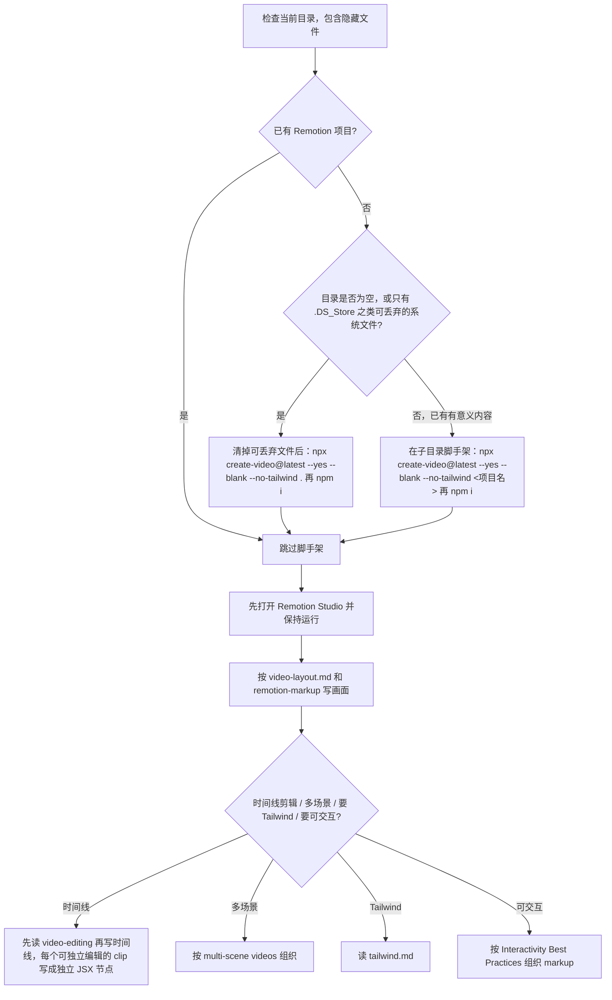

# remotion-create

创建新的 Remotion 项目和 composition：必要时先脚手架，再立即打开 Studio，然后按视频排版规范写 React 画面。

## 做什么

- **使用场景**：从零做一个 Remotion 视频，或在已有项目里新建 composition。
- **触发方式**：用户要「做 / 创建 / 构建」新视频或新 composition。总路由技能 `remotion-best-practices` 在这种请求时会加载本技能（即使项目已经存在）。
- **输入**：目标文件夹（空目录或已有项目）、可选的项目名、是否使用 Tailwind、视频是时间线剪辑还是多场景等需求。
- **输出**：一个可运行的 Remotion 项目（或新 composition），Studio 已打开，画面按本技能的布局规则开始搭建。

技能版本标注为 `4.0.534`。若当前任务不是「新建视频」，应改用 [remotion-best-practices](../remotion-best-practices/README.md)。

## 设计

脚手架只是起点。本技能强调三件事：选对落点目录、先预览再写画面、按「这是视频不是网页」来排版。后续的标记、交互、多场景等，再转到对应专项技能。



关键取舍和约束：

- `create-video` 拒绝非空目录，所以空目录可以直接在当前文件夹创建；目录里若已有有意义内容（包括 `.env`、`.git` 等），必须放到子目录。不要把所有隐藏文件都当成可删文件：只删除像 `.DS_Store` 这种一次性系统元数据。
- 默认脚手架参数是 `--yes --blank --no-tailwind`，即空白模板、不启用 Tailwind。用户点名要 Tailwind 时再按 `tailwind.md` 安装。
- 项目能跑之后、写 composition 之前就打开 Studio；已有项目也要在改视频前先打开，并一直开着。
- 注册 `<Composition>` / `<Still>` 之前，要遵循「Compositions and stills」的写法。
- 若视频是多段视频/音频剪辑的时间线，写时间线之前先看 Video editing，并且每个需要独立编辑的 clip 都写成单独的 JSX 节点。

## 技术实现

### 脚手架命令

先确认已安装 Node.js 和 Git，并且当前文件夹适合作为项目起点。

空目录（只先删掉可丢弃的系统文件）：

```bash
npx create-video@latest --yes --blank --no-tailwind .
npm i
```

非空且尚无项目：

```bash
npx create-video@latest --yes --blank --no-tailwind my-video
cd my-video
npm i
```

把 `my-video` 换成合适的项目名。

### 布局规则（`video-layout.md`）

这是视频构图，不是网页：

- 先决定每场观众应该首先注意到什么，画面围着这一件事来做。
- 重要内容留出足够安全边距。以 1080px 宽为例：关键文字至少离左右 80px、离上下 100px。
- 不要加多余元素。
- 1080px 宽时的粗略最小字号：主标题 84px，重要辅助文字 44px。其他宽度按画幅比例缩放。

### Tailwind（`tailwind.md`）

- 项目里已经装了 Tailwind，就可以而且应该用。
- 不要使用 `transition-*` 或 `animate-*` 类，动画一律用 `useCurrentFrame()`。
- 需先按官方文档安装并启用：https://www.remotion.dev/docs/tailwind

### 文件结构

| 文件 | 作用 |
|---|---|
| `SKILL.md` | 脚手架策略、何时打开 Studio、以及后续应转到哪些专项技能。 |
| `video-layout.md` | 视频优先的构图和字号规则。 |
| `tailwind.md` | 在 Remotion 里使用 Tailwind 的注意事项。 |
| `agents/openai.yaml` | Agent 界面元数据。 |
| `assets/remotion-icon.svg` | 技能图标。 |

完成后的跟进提示应改走 [remotion-best-practices](../remotion-best-practices/README.md)。React 标记细节见 [remotion-markup](../remotion-markup/README.md)，预览见 [remotion-studio](../remotion-studio/README.md)。

### 依赖与环境

Node.js、Git、npm（或项目指定的包管理器）。脚手架会安装 Remotion 及其依赖。

## 使用示例

用户：「用 Remotion 做一个 1080p 的产品介绍视频。」

1. 检查当前目录；若不是空的，在 `product-intro/` 下脚手架空白模板。
2. `npm i` 后立即 `npx remotion studio`。
3. 按安全边距和字号规则写主标题与场景，而不是按网页排版来做。
4. 若是多段素材拼接，先按视频剪辑规则给每个 clip 独立的 JSX 节点。

## 已知限制 / 注意事项

- `create-video` 不能在含有有意义内容的目录里直接运行。
- 默认不启用 Tailwind；启用后也禁止用 Tailwind 的动画类做过渡。
- 本技能不负责最终导出，导出见 [remotion-render](../remotion-render/README.md)。
