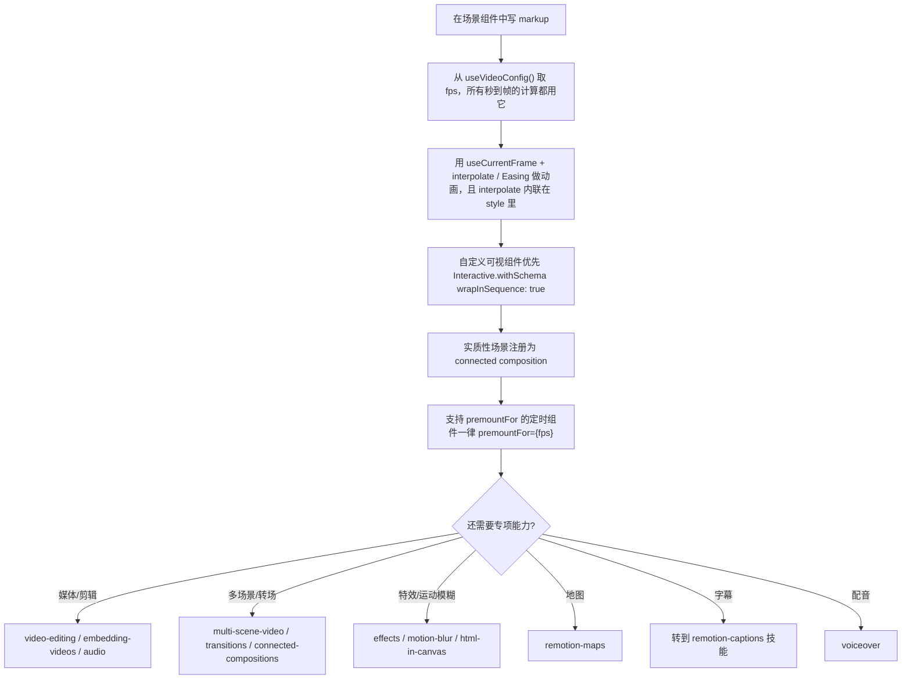

# remotion-markup

编写 Remotion React 标记的实践指南：动画必须由帧驱动，时间轴属性写在可编辑的 JSX 节点上，并按主题查阅本目录里的专项文档。

## 做什么

- **使用场景**：在 composition 或场景组件里写画面、动画、媒体、字幕、转场、特效、3D、配音等。
- **触发方式**：开始写或修改 Remotion React Markup 时，由本技能或 `remotion-best-practices` 加载。若当前任务与写标记无关，应改回 Best Practices。
- **输入**：已有（或刚脚手架好的）Remotion 项目，以及要做的画面需求。
- **输出**：符合 Studio 可编辑约定的 React 组件和 composition 注册，必要时安装对应的 `@remotion/*` 包。

技能版本标注为 `4.0.534`。写标记的同时，若发现用户在对话外改过代码，不要覆盖，视为有意修改或先确认。

## 设计

核心思路有三条：

1. **用当前帧驱动一切动画**，不用 CSS / Tailwind 的 transition 或 animation（它们在渲染时不会正确逐帧计算）。
2. **把时间与可编辑属性直接写在 JSX 节点上**，让 Studio 能选中、改关键帧并回写源码。需要独立编辑的元素不要用 `.map()` 批量生成（除非本来就打算共用一个模板）。
3. **能用组件自带的 timing / effects 就不要外套无意义的 `<Sequence>` 或用 CSS 近似特效**。



关键规则（来自 `SKILL.md`）：

- 秒到帧（`from`、`trimBefore`、`durationInFrames`、`premountFor` 等）必须用 `fps` 表达式写在 JSX 上，例如 `trimBefore={4 * fps}`，这样帧率变化时仍然正确，Studio 也能改时间。
- `interpolate()` 留在 `style` 里内联。优先用 CSS 的 `scale` / `translate` / `rotate` 简写，不要拼 `transform` 字符串，也不要把插值结果先存进变量（否则 Studio 很难编辑）。
- `scale` 动画使用 `output: "perceptual-scale"`。缓动用 `Easing.bezier()` 或 `Easing.spring()`。
- 资源放在项目根的 `public/`，用 `staticFile()` 引用；远程 URL 也可以直接传给媒体组件。
- 视频和音频用 `@remotion/media` 的 `<Video>` / `<Audio>`；静态图用 `<CanvasImage>`；GIF / APNG / WebP / AVIF 用 `<AnimatedImage>`，若不用 Chrome 再用 `@remotion/gif`。
- 每个支持 `premountFor` 的定时组件都给一秒预挂载：`premountFor={fps}`。包括媒体、交互组件、`<Sequence>`、`<Series.Sequence>`、`<TransitionSeries.Sequence>`、`<TransitionSeries.Overlay>`，以及嵌在场景里的定时子项。若子项需要在父级开始前挂载，父级时间轴也要 premount。没有该属性的组件（如 `<TransitionSeries.Transition>`）不必找替代。
- Studio 的「Pre-compose」请求必须做成真正的 connected composition：抽出命名组件（最好带 schema）、在 root 用同一引用注册独立 `<Composition>`（尺寸、fps、时长、`defaultProps` 与父级用法等价），并带上从父级继承的字体等样式。只抽组件却不注册 composition，不算完成。

## 技术实现

### 通用动画写法

```tsx
import { useCurrentFrame, useVideoConfig, Easing, interpolate, Interactive } from "remotion";

export const FadeIn = () => {
  const frame = useCurrentFrame();
  const {fps} = useVideoConfig();

  return (
    <Interactive.Div
      name="Title"
      premountFor={fps}
      style={{
        opacity: interpolate(frame, [0, 2 * fps], [0, 1], {
          extrapolateRight: "clamp",
          extrapolateLeft: "clamp",
          easing: Easing.bezier(0.16, 1, 0.3, 1),
        }),
      }}
    >
      Hello World!
    </Interactive.Div>
  );
};
```

安装与 Remotion 相关的包时一律使用：

```bash
npx remotion add @remotion/media
```

这也适用于其他 `@remotion/*`、`mediabunny`、`@mediabunny/*`、`zod`、`@huggingface/transformers`。

视觉检查：打开 Studio 做交互预览；也可以用渲染导出一帧或多帧图片来核对。

### `effects` 的使用方式

若目标组件支持 `effects`，且内置效果能满足需求，优先用 `@remotion/effects`，不要用 CSS 近似。例如给某段 `<Video>` 加暗角，就把 `vignette()` 放在它的 `effects` 上。

直接接受 `effects` 的组件：

- `remotion`：``、`<CanvasImage>`、`<AnimatedImage>`、`<Solid>`、`<HtmlInCanvas>`
- `@remotion/media`：`<Video>`
- `@remotion/gif`：`<Gif>`
- `@remotion/rive`：`<RemotionRiveCanvas>`
- `@remotion/shapes`：箭头、圆形、星形等形状组件

普通 HTML、`<Interactive.*>`、`<AbsoluteFill>`、`<Sequence>` 不能直接加 `effects`，需要包在 `<HtmlInCanvas>` 里，把 `effects` 放在该包装上。无内置效果时再用 `createEffect()` 写自定义效果。内置效果分组见 `SKILL.md`（颜色/影调、模糊与拖影、灯光、畸变、纹理、边缘、像素化与转场等）。

### 文件结构（本目录文档逐项说明）

| 文件 | 作用 |
|---|---|
| `SKILL.md` | 总则、媒体组件约定、示例场景（背景视频 + 可交互 Lower Third）、特效总表，以及下面各专项文档的入口。 |
| `agents/openai.yaml` | Agent 界面元数据。 |
| `assets/remotion-icon.svg` | 技能图标。 |
| `compositions.md` | 如何注册 `<Composition>` / `<Still>`：每个要在 Studio 里独立编辑的成片写成独立 JSX 节点，`id` 用字符串字面量，元数据和 default props 写在该节点上。 |
| `connected-compositions.md` | 类似 After Effects 预合成：让一组图层拥有自己的 Studio 时间轴。组件需独立于父级样式（如自行加载字体）。 |
| `timing-props.md` | 延迟、裁切等 timing 属性、支持这些属性的组件，以及运算顺序。 |
| `timing.md` | `interpolate()` 的更多技巧；默认不钳制，需要时再 `clamp`；用 `Easing.bezier` / `Easing.spring`。 |
| `sequencing.md` | 进阶编排：能写在组件上的 timing 就不要外包 `<Sequence>`；多个子项共享时钟、或子项不接受 timing 时再用 `<Sequence>`（可用 `layout="none"`）。 |
| `video-editing.md` | 可编辑时间线：每个要单独裁切/移动/复制的 clip 必须是独立 JSX 节点，不要用循环生成（除非共用模板）。 |
| `multi-scene-video.md` | 多场景：每场独立组件和文件，注册为 connected composition；可能有转场时用 `<TransitionSeries>`（需 `@remotion/transitions`）。 |
| `transitions.md` | `<TransitionSeries.Transition>` 会缩短时间轴（两场重叠）；`<TransitionSeries.Overlay>` 只在切点上叠效果，不缩短时间轴。Transition 本身不接受 `premountFor`。 |
| `parameters.md` | 用 Zod schema 让 composition 可参数化，并在 root 里把 schema 传给 `<Composition>`。 |
| `calculate-metadata.md` | 用 `calculateMetadata` 按 props、远程数据或素材元数据动态设置时长、尺寸和 props；静态值则直接写在 `<Composition>` 上。 |
| `embedding-videos.md` | 嵌入视频的裁切、音量、速度、循环、音高。 |
| `audio.md` | 音频的导入、裁切、音量、速度、音高；多轨可叠加。 |
| `voiceover.md` | 默认用 ElevenLabs TTS（环境变量 `ELEVENLABS_API_KEY`）按场景生成 MP3 到 `public/`，再用 `calculateMetadata` 按音频时长确定 composition 长度。可换成任何能产出音频文件的 TTS。 |
| `sfx.md` | 用 `<Audio>` 播放音效；列出一批 `https://remotion.media/...wav` 现成音效，更多可参考 skill 中给出的素材库链接。 |
| `audio-visualization.md` | 频谱、波形、低频驱动效果；安装 `@remotion/media-utils`，用 `useWindowedAudioData()` 加载音频数据。 |
| `silence-detection.md` | 先用 `loudnorm=print_format=json` 测响度，再把 `input_thresh` 作为 `silencedetect` 的 `noise`（默认最短静音 0.5 秒），识别片头/片尾静音后用 `trimBefore` / `durationInFrames` 裁掉。 |
| `ffmpeg.md` | 不必单独安装 ffmpeg/ffprobe，使用 `npx remotion ffmpeg` 和 `npx remotion ffprobe`。 |
| `cropping.md` | 优先用 `cropLeft` / `cropRight` / `cropTop` / `cropBottom`，以便在画布上拖拽并看到裁切轮廓。 |
| `effects.md` | 安装 `@remotion/effects`，内置参数、以及 `createEffect()` 自定义效果。 |
| `light-leaks.md` | Remotion 4.0.500+ 的 `lightLeak()`，通常放在 `<TransitionSeries.Overlay>` 里，把 `progress` 从 0 动画到 1。 |
| `motion-blur.md` | 帧驱动运动模糊。首选 `<HtmlInCanvasMotionBlur>`（4.0.529+），在小数帧采样后做像素平均；也介绍 `@remotion/motion-blur`。 |
| `html-in-canvas.md` | 把子树画进 canvas 以便做后期。仅 Chrome 149+ 且需打开 `chrome://flags/#canvas-draw-element`；嵌套还要更新年份的 Chrome，并先检查 `HtmlInCanvas.isNestingSupported()`。 |
| `images.md` | 图片尺寸与定位、动态路径、读取图片宽高。 |
| `gifs.md` | 用 `<AnimatedImage>` 让 GIF/APNG/WebP/AVIF 与时间轴同步。 |
| `lottie.md` | 用 `@remotion/lottie` 嵌入 Lottie。 |
| `google-fonts.md` | 推荐用 `@remotion/google-fonts` 加载字体（类型安全，并会阻塞到字体就绪）。 |
| `local-fonts.md` | 用 `@remotion/fonts` 加载本地字体文件。 |
| `text-highlights.md` | 用 `@remotion/rough-notation` 做高亮、圆圈、下划线、删除线、方框等注释动画。 |
| `measuring-text.md` | 用 `@remotion/layout-utils` 测量文字、适配容器、检查溢出。 |
| `measuring-dom-nodes.md` | Remotion 会给容器加 `scale()`，`getBoundingClientRect()` 需配合 `useCurrentScale()` 才准确。 |
| `3d.md` | Three.js / React Three Fiber：必须包在带 `width`/`height` 的 `<ThreeCanvas>` 里并加灯光；禁止 `useFrame()` 和一切非 `useCurrentFrame()` 驱动的自转动画，否则渲染会闪烁。 |
| `remotion-maps/` | 地图专项（见下）。 |

#### `remotion-maps/` 子树

地图总入口是 `remotion-maps/REFERENCE.md`：先按镜头只选一种 technique，只读该目录的 `TECHNIQUE.md`。

| 路径 | 作用 |
|---|---|
| `remotion-maps/REFERENCE.md` | 在 static-map、Mapbox、MapLibre、MapTiler、CesiumJS 中选择一种。 |
| `remotion-maps/agents/openai.yaml`、`assets/remotion-icon.svg` | 子技能的界面元数据与图标。 |
| `techniques/static-map/TECHNIQUE.md` | 把卫星图放进 ``，在图上做动画。 |
| `techniques/mapbox/TECHNIQUE.md` 与 `references/render-stability.md` | Mapbox GL JS + Turf；需要 `REMOTION_MAPBOX_TOKEN`。 |
| `techniques/maplibre/TECHNIQUE.md` 与 `references/render-stability.md` | 无需 API key，无 3D 建筑。 |
| `techniques/maptiler/` | 地理讲解：`TECHNIQUE.md`，示例组件 `CountryLabel.tsx`、`RiverReveal.tsx`、`MapTilerVectorElement.ts`、`example-Root.tsx`，视觉示例 `assets/tokens.ts`（须换成项目自己的色板，不是密钥），样本数据，`scripts/prep-geo.mjs`，以及数据源 / 架构 / 地理预处理 / 渲染稳定性参考。 |
| `techniques/cesium/` | 三维飞越：`CesiumFlythrough.tsx`、路径 JSON、`flight-path.ts`、示例 Root、河流 GeoJSON、`scripts/prep-cesium-path.mjs`，以及数据源 / 架构 / 排错参考。城市模式需要 `REMOTION_GOOGLE_MAPS_API_KEY`。 |

### 依赖与环境

- 项目已安装 Remotion。新增官方包用 `npx remotion add`。
- Zod 参数化、特效、字体、Lottie、3D、字幕等按对应文档另装包。
- `<HtmlInCanvas>` / 部分运动模糊需要足够新的 Chrome 和指定 flag。
- 配音、地图可能需要环境变量中的 API key，不要写入仓库或聊天。

## 使用示例

用户：「做一个 16:9 的产品介绍，先全屏背景视频，一秒钟后淡入人名条，两场之间加转场。」

1. 背景用 `@remotion/media` 的 `<Video premountFor={fps}>`。
2. Lower Third 做成 `Interactive.withSchema({wrapInSequence: true})`，并在 root 注册为 connected composition；调用处写 `from={1 * fps}`，淡入的 `interpolate` 内联在 `style` 上。
3. 两场用 `<TransitionSeries>`，每场 `durationInFrames` 和 `premountFor={fps}` 写在对应 Sequence 上。
4. 打开 Studio，确认可以点选人名条、改颜色和入点。

## 已知限制 / 注意事项

- CSS / Tailwind 动画类不能正确渲染，必须改成帧驱动。
- 循环生成的多个实例在 Studio 里会共用一个源节点，无法逐个编辑。
- 普通 DOM 节点不能直接加 `effects`。
- `<HtmlInCanvas>` 有浏览器版本和 flag 限制，需告知用户。
- 3D 内容禁止 `useFrame()`，否则导出时会闪。
- 本目录内的 `remotion-maps` 与 `remotion-best-practices/remotion-maps` 是同类资料的拷贝，改动时要注意一致性。
