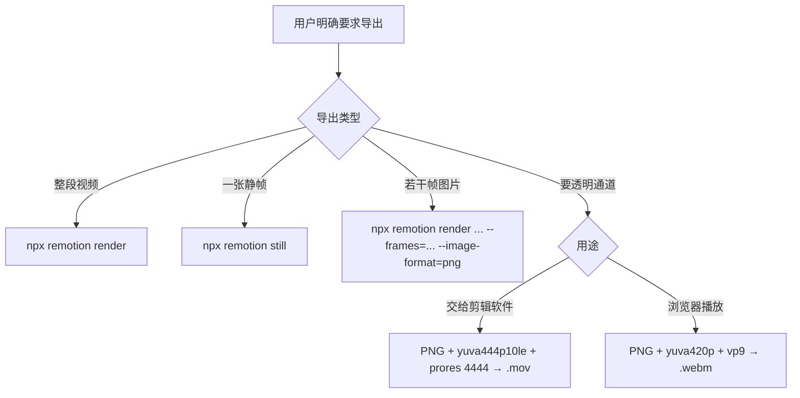

# remotion-render

把 Remotion composition 导出为视频、静帧，或一次导出若干张图片帧；需要透明通道时按本技能的编码组合来渲染。

## 做什么

- **使用场景**：用户明确要求「渲染 / 导出 / 给我 MP4」，或需要抽帧检查画面、导出透明素材。
- **触发方式**：说得很明确的导出请求。按 Remotion 总路由（`remotion-best-practices`）的约定，没说要渲染时默认只开 Studio 预览。
- **输入**：项目、composition id、可选帧范围、编码器和输出路径。
- **输出**：视频文件（如 MP4 / MOV / WebM）、一张静帧，或一组 PNG 帧。

技能版本标注为 `4.0.534`。更完整的 CLI 选项见官方文档：[render](https://www.remotion.dev/docs/cli/render.md)、[still](https://www.remotion.dev/docs/cli/still.md)、[`--frames`](https://www.remotion.dev/docs/cli/render.md#--frames)。

## 设计

渲染被当成「明确请求才执行」的步骤，因为 Studio 里也有更直观的导出界面。本技能把常见导出分成三类：整段视频、单张静帧、指定帧的图片序列；透明视频再单独说明，因为必须同时改图像格式、像素格式和编码器，漏一项就没有 Alpha。



关键取舍：

- 透明 ProRes 适合导入剪辑软件；透明 WebM（VP9）适合浏览器播放。
- 三种设置途径：CLI 一次性指定、在 `remotion.config.ts` 里设 Studio 默认值（改完要重启 Studio）、或在 composition 的 `calculateMetadata` 里设该成片的默认导出参数。
- 注意：透明 WebM 的 CLI 示例使用 `--codec=vp9`，而 `calculateMetadata` 示例写的是 `defaultCodec: "vp8"`，以技能原文为准，不要擅自改成同一编码器。

## 技术实现

### 命令

```bash
# 渲染视频
npx remotion render

# 渲染静帧
npx remotion still

# 一次导出多帧为图片
npx remotion render [composition-id] out/frames --frames=0,30,90 --image-format=png
```

### 透明视频参数

**透明 ProRes（.mov）：**

```bash
npx remotion render --image-format=png --pixel-format=yuva444p10le --codec=prores --prores-profile=4444 MyComp out.mov
```

对应配置：`Config.setVideoImageFormat("png")`、`setPixelFormat("yuva444p10le")`、`setCodec("prores")`、`setProResProfile("4444")`。

**透明 WebM VP9：**

```bash
npx remotion render --image-format=png --pixel-format=yuva420p --codec=vp9 MyComp out.webm
```

对应配置：图像格式 `png`，像素格式 `yuva420p`，编码器 `vp9`。若走 `calculateMetadata`，技能示例使用 `defaultCodec: "vp8"`，同样搭配 `defaultVideoImageFormat: "png"` 和 `defaultPixelFormat: "yuva420p"`。

### 文件结构

| 文件 | 作用 |
|---|---|
| `SKILL.md` | 总体导出策略和三条主命令。 |
| `transparent-videos.md` | 透明 ProRes / WebM 的 CLI、Studio 默认配置和 `calculateMetadata` 写法。 |
| `agents/openai.yaml` | Agent 界面元数据（显示名、图标、品牌色）。 |
| `assets/remotion-icon.svg` | 技能图标。 |

### 依赖与环境

需要可用的 Remotion CLI（通常经 `npx remotion`）以及项目依赖。透明导出还依赖 FFmpeg 对 ProRes 4444 或 VP8/VP9 带 Alpha 像素格式的支持（由 Remotion 调用）。

## 使用示例

用户：「把 MyComp 导出成 MP4。」

```bash
npx remotion render MyComp out/video.mp4
```

用户：「给我一张带透明底的 WebM。」

```bash
npx remotion render --image-format=png --pixel-format=yuva420p --codec=vp9 MyComp out/overlay.webm
```

用户：「导出第 0、30、90 帧看看字幕位置。」

```bash
npx remotion render MyComp out/frames --frames=0,30,90 --image-format=png
```

## 已知限制 / 注意事项

- 不要在用户只说「做个视频」时就渲染，先开 Studio。
- 改 `remotion.config.ts` 里的默认导出设置后，需要重启 Studio 才生效。
- 透明 WebM 示例里 CLI 用 `vp9`、`calculateMetadata` 示例用 `vp8`，按对应途径照抄，不要混用文档。
- 更完整的参数以官方 CLI 文档为准，本技能只覆盖常用路径和透明导出。
