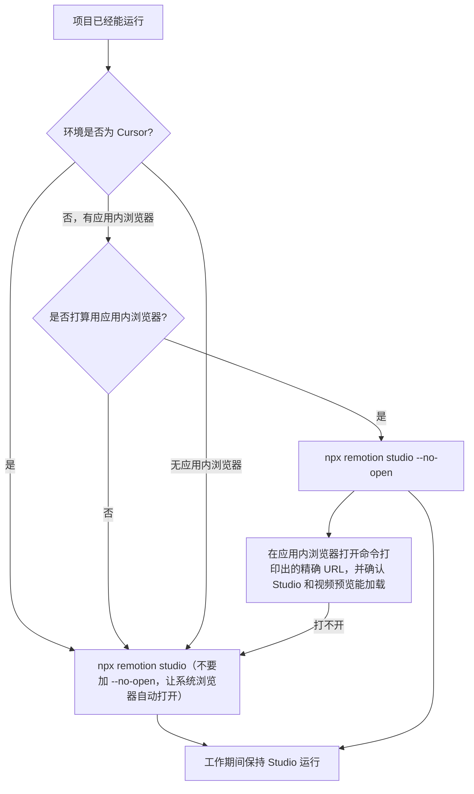

# remotion-studio

在创建或编辑 Remotion 视频时，尽早启动 Remotion Studio，并在浏览器里打开预览，让用户边看边改。

## 做什么

- **使用场景**：新项目刚脚手架完、已有项目准备改画面、或用户要看某个 composition 的预览。
- **触发方式**：做视频、改视频，或需要打开 / 配置 Studio。官方 Agent 界面上的短名是 `/remotion-studio`。
- **输入**：一个已经能运行的 Remotion 项目路径；可选端口、日志级别，或指定 composition id。
- **输出**：本机 Studio 服务（默认会打印 URL，常见为 `http://localhost:3000`）。打开后可在 `/[composition-id]` 查看具体成片，例如 `http://localhost:3000/MapAnimation`。

技能版本标注为 `4.0.534`。

## 设计

默认策略是「先预览，后渲染」：项目一旦能跑，就先开 Studio，再写或改 composition，并且保持进程不关。这样用户能看到热更新，及时纠偏。渲染交给 `remotion-render`，且通常要用户说得很明确才做。



关键取舍：

- 若 Studio 已经在跑，再执行命令通常会打印已有 URL 然后退出，而不是再起一个进程。
- 只有在确认能打开打印出的 URL 时才用 `--no-open`；否则不要加这个参数，以免用户看不到预览。
- 需要再开一个实例时，用 `--force-new`，即使同一项目、同一端口已有 Studio。

## 技术实现

### 命令与参数

主命令：`npx remotion studio`。

| 参数 | 作用 |
|---|---|
| `--no-open` | 不自动打开系统浏览器，只启动服务并打印 URL，供应用内浏览器使用 |
| `--log=<level>` | 日志级别：`error`、`warn`、`info`（默认）、`verbose` |
| `--port=<number>` | 指定端口；不设则由 Remotion 找空闲端口 |
| `--force-new` | 即使同一项目、同一端口已有实例，也再启动一个 Studio |

访问某个 composition：打开 `/[composition-id]`。

### 文件结构

| 文件 | 作用 |
|---|---|
| `SKILL.md` | 启动策略、适用环境和 CLI 参数。 |
| `agents/openai.yaml` | Agent 界面元数据：显示名 `/remotion-studio`、短描述、图标和品牌色 `#0B84F3`，以及默认提示 `$remotion-studio.`。 |
| `assets/remotion-icon.svg` | 技能图标。 |

### 依赖与环境

需要已安装依赖的 Remotion 项目，以及可用的 Node.js / `npx`。Studio 是一个长期运行的本地 HTTP 服务。

## 使用示例

项目刚执行完 `npm i`，先运行：

```bash
npx remotion studio
```

然后在浏览器里确认空白模板的预览能出来，再开始改 `src/` 里的 composition。需要固定端口时加上 `--port=3000`。

## 已知限制 / 注意事项

- 本技能只负责预览和 Studio 的启动参数，不包含渲染选项（见 [remotion-render](../remotion-render/README.md)）。
- `--no-open` 时必须打开「命令实际打印的 URL」，不要凭猜测拼地址（端口可能不是 3000）。
- 已有实例时，普通再次调用可能直接退出，只回现有 URL；要第二个实例需 `--force-new`。
