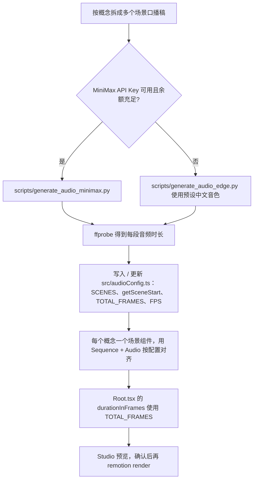

# remotion-video

用 Remotion（React）编程式制作 MP4 视频的技能，重点是「音频驱动场景」的教程/讲解片，并集成 MiniMax 或 Edge TTS 配音。

本技能来自第三方仓库 [wshuyi/remotion-video-skill](https://github.com/wshuyi/remotion-video-skill)（安装说明见原 README）。英文版说明保留在 [README_EN.md](./README_EN.md)。

它和官方 Remotion 路由技能（[remotion-best-practices](../remotion-best-practices/README.md) 等）是互补关系：官方技能覆盖脚手架、Studio、标记规范和导出；本技能补充中文工作流、TTS 脚本，以及教程/3D 讲解片的架构与踩坑经验。

## 做什么

- **使用场景**（来自技能描述）：
  - 程序化视频：批量生成、数据驱动（如年度总结）、音乐可视化、自动字幕。
  - 教程讲解：技术概念可视化（如 CNN、算法）、分层递进讲解、AI 配音教程。
  - 3D 视频：产品展示/模型动画、卡通角色讲解、3D 数据可视化、Logo 动画。
- **触发方式**：用户说「用代码做视频」「编程视频」「React 视频」「Remotion」「remotion」，或 `/remotion-video`。
- **输入**：视频主题与脚本（或要讲解的概念）、可选的音色 / API Key、素材。
- **输出**：Remotion 项目（场景组件 + `audioConfig.ts` + `public/audio/` 中的配音），以及最终渲染的视频文件。

## 设计

本技能最关键的设计是：**音频决定时长，`audioConfig.ts` 是音画同步的单一数据源**。先写各场景口播稿，用 TTS 生成音频并测量时长，再反推每场的 `durationInFrames` 和成片总帧数，而不是先拍画面再硬塞旁白。



关键取舍和约束：

- **一个概念 = 一个场景 = 一段音频**。不要把整支教程塞进一个大场景。
- **配音优先级**：首选 MiniMax TTS（云端克隆、速度快、音质好，按字符计费）；不可用时退回 Edge TTS（免费、零配置，但固定音色，默认 `zh-CN-YunyangNeural`）。
- MiniMax 国际版域名是 `api.minimax.io`，国内版是 `api.minimaxi.com`。`api.minimax.chat` 是错误域名，会返回 `invalid api key`。
- MiniMax 脚本支持断点续作（已有非空 mp3 则跳过）、前台打印进度，并在全部完成后自动重写 `audioConfig.ts`。Edge 脚本会打印配置片段，但不会自动写 TypeScript 文件。
- 生成 TypeScript 时，必须在 f-string 外用真正的换行符拼接。错误地写 `",\n".join()` 会在文件里留下字面量 `\n`，导致 `Syntax error "n"`。
- 教程片建议借鉴 3Blue1Brown：先问 Why 再展示 What、元素逐步出现、颜色有语义、2D 优先、一个场景一个概念。
- 过程动画（展示「怎么算」而不只是「是什么」）时，脚本要给动画留白；首次完整展示，重复步骤再加速。
- 3D 场景同时只渲染一个 `ThreeCanvas` / 当前附近的场景，避免 WebGL 上下文耗尽。相机不要用「永远逼近但到不了」的插值，否则画面会持续微抖。

## 技术实现

### Remotion 核心 API（技能正文中的基础）

| 概念 | 作用 |
|---|---|
| `<Composition>` | 定义成片的尺寸、帧率、时长和根组件 |
| `useCurrentFrame()` | 取当前帧，驱动动画 |
| `interpolate()` | 把帧号映射到位置、透明度等；常用 `extrapolateRight: "clamp"` |
| `spring()` | 物理弹簧动画 |
| `<Sequence>` | 在时间轴上排列组件；其内部的 `useCurrentFrame()` 从 0 起算（相对该 Sequence），不是全局帧号 |
| `staticFile()` | 引用 `public/` 下的音频、图片、视频 |

新建项目的快捷方式是 `npx create-video@latest`，然后 `npm run dev` 打开 Studio。3D 新手可用 `npx create-video@latest --template three`。

技能中给出的典型项目结构：

```text
my-video/
├── src/
│   ├── Root.tsx           # 注册 Composition
│   ├── HelloWorld.tsx     # 视频组件
│   └── index.ts
├── public/                # 静态资源
├── remotion.config.ts
└── package.json
```

教程类项目还会有 `src/audioConfig.ts`、`src/scenes/`、`public/audio/` 和 `scripts/generate_audio_*.py`。

### TTS 脚本

#### `scripts/generate_audio_minimax.py`

- 环境变量：`MINIMAX_API_KEY`、`MINIMAX_VOICE_ID`（缺一不可，脚本会退出）。
- 请求：`POST https://api.minimax.io/v1/t2a_v2`（国内版改注释中的 `api.minimaxi.com`）。
- 默认模型 `speech-02-hd`；`voice_setting` 含 `voice_id` / `speed` / `vol` / `pitch`；音频为 32 kHz、128 kbps、mp3、单声道。
- 返回的音频是 hex，解码后写入 `public/audio/<id>.mp3`。时长优先用接口的 `extra_info.audio_length`（毫秒），否则用 `ffprobe`。
- 帧数按 30 fps：`frames = round(duration * 30)`。
- `SCENES` 写在脚本里，需按实际口播修改。
- `update_config()` 会覆盖 `src/audioConfig.ts`，并声明「自动生成，请勿手动修改」。`TOTAL_FRAMES` 为各场帧数之和再加 60 帧缓冲。

技能中的价格参考（标注为 2025 年）：`speech-02-hd` ¥0.1/千字符，`speech-02-turbo` ¥0.05/千字符。以平台当时定价为准。

#### `scripts/generate_audio_edge.py`

- 依赖：`pip install edge-tts`。无需 API Key。
- 使用 `edge_tts.Communicate(text, VOICE).save(...)`，默认音色 `zh-CN-YunyangNeural`（云扬）。技能还列出晓晓、云希。
- 同样用 `ffprobe` 测时长，按 30 fps 换算帧数，并打印可供粘贴的配置行。不自动写 `audioConfig.ts`。

两份脚本都通过：

```bash
ffprobe -v quiet -show_entries format=duration -of default=noprint_wrappers=1:nokey=1 <file>
```

读取时长，因此系统需要 `ffprobe`（通常随 FFmpeg 安装）。

### `templates/audioConfig.ts`

给 Remotion 侧用的配置模板：

- `SceneConfig`：`id`、`title`、`durationInFrames`、`audioFile`
- `SCENES` 数组
- `getSceneStart(sceneIndex)`：前面所有场景时长之和
- `TOTAL_FRAMES`：总和 + 60
- `FPS = 30`

主成片里用 `useCurrentSceneIndex()` 按累计帧数判断当前场景，并用

```tsx
{SCENES.map((scene, idx) => (
  <Sequence key={scene.id} from={getSceneStart(idx)} durationInFrames={scene.durationInFrames}>
    <Audio src={staticFile(`audio/${scene.audioFile}`)} />
  </Sequence>
))}
```

对齐配音。`Root.tsx` 的 `durationInFrames={TOTAL_FRAMES}`。

### 3D 与渲染要点（摘自技能正文）

- 安装：`three`、`@react-three/fiber`、`@remotion/three`、`@types/three`；常用 `@react-three/drei`（`useGLTF`、`Text`、`OrthographicCamera`）。
- 3D 内容放在 `<ThreeCanvas width={width} height={height}>` 中。
- 视频当纹理：预览可用 `useVideoTexture`，渲染用 `useOffthreadVideoTexture` 保证帧精确。
- WebGL 上下文不够时：`remotion.config.ts` 或 CLI 使用 `--gl=angle`（或 `angle-egl`）；并用场景索引 / 缓冲帧做懒加载，只渲染当前时间附近的 3D 内容。
- 网格图像必须 `col → x`、`row → y` 且翻转 row，否则会像旋转了 90 度。
- 进度变量必须 `clamp` 到 `[0, 1]`，否则可能出现几千 percent 的进度。
- 技能还涵盖：参数化 composition（Zod）、`npx remotion render` 的常见编码器、`@remotion/captions` + Whisper、`@remotion/player`、`@remotion/lambda` 等。官方技能里有更新、更细的对应文档时，应优先对照那些专项技能。

推荐的 npm scripts 示例：

```json
{
  "scripts": {
    "dev": "remotion studio",
    "audio": "python3 scripts/generate_audio.py",
    "render": "remotion render MyVideo out/video.mp4",
    "build": "npm run audio && npm run render"
  }
}
```

音频生成和渲染都可能较久，技能要求前台执行以便看到进度，不要随手丢到后台。

### 文件结构

| 文件 | 作用 |
|---|---|
| `SKILL.md` | 完整中文指南：基础 API、两种 TTS、教程架构、3D、3B1B 风格、过程动画、工作流与踩坑。 |
| `README.md` | 本介绍。 |
| `README_EN.md` | 上游英文安装与用法说明。 |
| `README_CN.md` | 上游较短的中文安装说明；完整设计与实现以本文件和 `SKILL.md` 为准。 |
| `scripts/generate_audio_minimax.py` | MiniMax TTS 批量生成、断点续作、回写 `audioConfig.ts`。 |
| `scripts/generate_audio_edge.py` | Edge TTS 免费配音，并打印配置。 |
| `templates/audioConfig.ts` | 场景配置 TypeScript 模板。 |

### 依赖与环境

- Node.js 18+（上游 README 要求）
- Python 3.8+（跑 TTS 脚本）
- `ffprobe` / FFmpeg（测音频时长）
- Edge TTS：`pip install edge-tts`
- MiniMax：有效的 `MINIMAX_API_KEY` 与 `MINIMAX_VOICE_ID`，以及 `requests` 库（脚本有 `import requests`）
- 做 3D 时还需 Three 相关 npm 包；服务端渲染 3D 必须配置 `chromiumOptions.gl`

密钥只放环境变量，不要写进脚本或仓库。

## 使用示例

用户：「帮我做一个讲解 CNN 卷积的教程视频，大约几分钟，用中文配音。」

1. 按「提出问题 → 逐步验证 → 总结」写分场口播，一场一个概念。
2. 把文案填进 TTS 脚本的 `SCENES`，能用 MiniMax 就用，否则 Edge TTS。
3. 前台运行生成脚本，确认 `public/audio/` 和 `audioConfig.ts`。
4. 为每场写场景组件（可用 2D/正交相机把卷积窗口的滑动算清楚），用 `SCENES` 驱动 `<Sequence>` + `<Audio>`。
5. `npm run dev` 预览音画是否对齐，再 `npx remotion render`。

## 已知限制 / 注意事项

- MiniMax 用错域名会报 `invalid api key`；余额不足时要退回 Edge TTS。
- Edge 脚本不会自动更新 `audioConfig.ts`，需要手动同步。
- Python 拼接 TypeScript 时不能把 `\n` 写进 f-string。
- 多个 `ThreeCanvas` 同时存在可能导致 WebGL 崩溃；相机插值若不收敛会一直抖动。
- 技能正文里的部分包用法（例如 `<Video>` 从 `remotion` 引入、`<OffthreadVideo>`）可能与官方较新的 `@remotion/media` 推荐不完全一致。遇到冲突时，以官方专项技能（markup / captions / render / studio）为准。
- 上游 README 中的「安装到 `~/.claude/skills/`」是给 Claude Code 用的路径说明；在本仓库里它只是作为 QBot 技能被收录。
