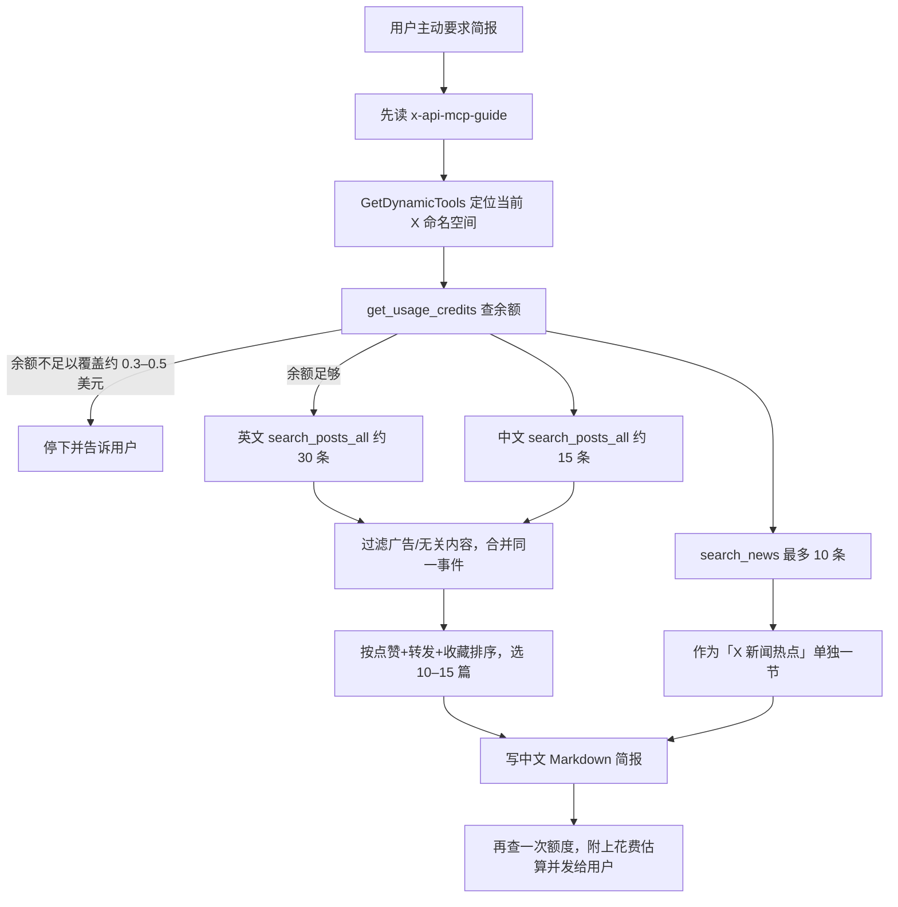

# x-ai

按用户请求，用 X 插件检索最近热门的 AI / 科技文章和帖子，整理成一份中文 Markdown 简报。

## 做什么

只在用户主动要求时运行，例如「X 上最近有什么火的 AI 文章」。不要定时自动跑。

- **使用场景**：想快速了解 X（Twitter）上近两天被广泛转发、点赞的 AI 与科技内容。
- **触发方式**：用户明确要 X 上的热门 / 最火 AI 或科技文章简报。
- **输入**：一次用户请求（可带主题偏好，但默认按技能里写死的检索式）。
- **输出**：写到 `/workspace/x-briefs/X热门AI科技文章-YYYY-MM-DD.md`（日期用北京时间）的中文简报，作为附件发给用户，并在对话里用几句话点出最值得看的三篇以及质量上的问题。

本目录只有 `SKILL.md`，没有额外脚本。检索走当前可用的 X 连接（MCP 命名空间，形如 `user-X` 或 `user-X--<账号>`）。

## 设计

这是一份「按需、限额、可审计」的简报流程：先估费用，再按固定检索式拉英文帖、中文帖和 X 新闻，过滤合并后输出，并把实际花费写进简报末尾。



关键取舍和约束：

- **只用用户请求触发**，避免定时任务在用户不知情时消耗额度。
- 搜索总花费上限约 0.6 美元；动手前预估约 0.3 到 0.5 美元，余额不够就停。
- 价目（技能中的参考）：每条帖子 0.005 美元，每个用户 0.01 美元，每条新闻 0.005 美元。接口若自动附带用户和被引用帖也会计费，因此尽量不要请求 `author_id` 等 expansions；用户名可以从帖子 `url` 里读出。
- 英文检索窗口是过去 48 小时，条件更严（`min_likes:500`）；中文门槛较低（`min_likes:200`），并排除「注册 / Muse / 封号」一类噪音。
- `search_news` 返回的是 X 用 Grok 写的话题摘要，不是外部媒体原文链接，所以单独成节，不和文章混在一起。
- 只保留指向文章、博客、论文、X 长文或确有实质内容的帖子；去掉广告、色情、账号注册/防封技巧、娱乐体育等。同一事件多篇报道合并成一条。
- 所有数字只能来自接口真实返回，不能估算或编造。

## 技术实现

### 用到的工具 / API

- 技能 `x-api-mcp-guide`：错误处理与成本规则，必须先读。
- `GetDynamicTools`：发现当前 X 连接命名空间。
- X MCP：
  - `get_usage_credits`：查询余额（开始前和结束后各一次）。
  - `search_posts_all`：全文检索帖子。
  - `search_news`：检索 X 新闻热点。

### 检索参数

英文（约 30 条，`start_time` 为过去 48 小时）：

```text
(AI OR LLM OR OpenAI OR Anthropic OR Claude OR Gemini OR Grok OR GPU OR startup OR robotics) has:links -is:retweet -is:reply lang:en min_likes:500
```

`post.fields` 请求 `created_at,public_metrics,author_id,entities`（`entities` 里有展开链接和标题）。尽管尽量避免 expansions，字段里仍包含 `author_id`，按技能原文请求即可。

中文（约 15 条）：AI / 大模型 / 科技类关键词，加上：

```text
has:links -is:retweet -is:reply lang:zh min_likes:200 -注册 -Muse -封号
```

新闻：用 AI / technology 搜索，最多 10 条。

### 简报结构

1. 标题 + 一句话说明搜索范围和筛选条件。
2. **今日必读**（3 到 5 篇）：标题、@分享者、北京时间、点赞/转发/收藏、两三句中文概括和为什么值得看、原帖链接和文章链接。
3. **其他热门**：每篇一两句。
4. **X 新闻热点**：每条一句加链接。
5. 结尾：读了多少帖子 / 用户 / 新闻、按价目估算的花费、剩余额度。

### 文件结构

| 文件 | 作用 |
|---|---|
| `SKILL.md` | 完整操作说明。检索实现依赖运行时的 X 插件，不在本目录。 |

### 依赖与环境

需要已连接且可用的 X MCP，以及足够的用量额度。输出目录为 `/workspace/x-briefs/`。日期按北京时间。

## 使用示例

用户：「X 上最近有什么火的 AI 文章？」

先读指南、查余额，再按上面的检索式拉取、筛选、写简报，把文件作为附件发出，并口头总结最值得看的三篇。

## 已知限制 / 注意事项

- 不是全网媒体监测，只覆盖 X 上带链接、且达到点赞门槛的帖子，以及 X 新闻摘要。
- 花费与返回条数、是否附带用户/引用有关，必须先查余额。
- 中文检索式里排除词是经验过滤，可能误伤个别相关帖。
- 简报中的互动数据以查询当时为准，之后会变。
