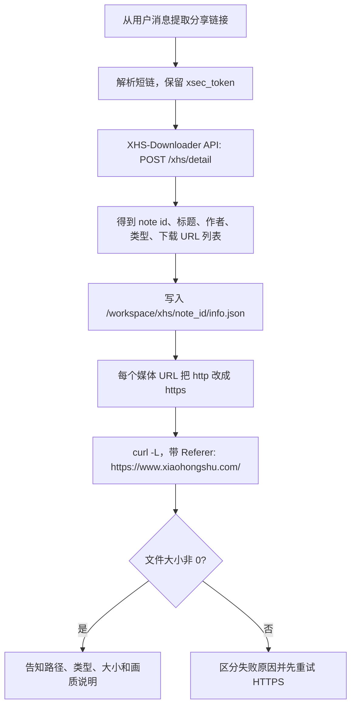

# xiaohongshu-download

用户贴出小红书 / RedNote / xhslink 分享链接，并希望保存视频、图片或笔记媒体时，把内容下载到本地，仅供个人离线使用。

## 做什么

- **使用场景**：收藏一条笔记的视频或图片，方便在本地查看或继续剪辑。
- **触发方式**：用户粘贴 `xiaohongshu.com`、`rednote.com`、`xhslink.com` 或 `xhslink.cn` 链接，并要求下载或保存。
- **输入**：一条（或用户明确指定的几条）分享链接；某些笔记可能需要 cookie 才能访问。
- **输出**：`/workspace/xhs/<note_id>/` 下的媒体文件（如 `video.mp4` 或 `01.webp` …）以及 `info.json`。回复里说明路径、类型、大小和画质方面的保留意见。

本目录只有 `SKILL.md`。实际抽取和下载依赖盒子上的开源工具和 `curl`，不使用来路不明的去水印网站。

## 设计

优先用本地开源工具解析笔记元数据和 CDN 地址，再用 `curl` 下载。解析和下载分开，是为了在这台机器上绕开一个具体的网络问题：解析器常返回 `http://sns-*.xhscdn.com/...`，而这里对这类主机的明文 HTTP 会挂起（0 字节，可能和 fake-ip DNS 有关），HTTPS 则可以。



工具优先级：

1. **解析**：`/workspace/tools/XHS-Downloader`（JoeanAmier）的本地 API，`download:false` 即可，只要详情和 URL。
2. **下载**：改写 CDN 为 HTTPS 后用 `curl`，并带小红书 Referer。
3. **视频兜底**：对带 `xsec_token` 的完整 explore URL 使用 `yt-dlp --impersonate chrome`；若超时仍要把 CDN 改成 HTTPS。
4. **手工**：官方 App「保存到相册」，或浏览器 DevTools Network 里找 `mp4`。

关键约束：

- 仅个人收藏 / 学习。未经作者许可，不要再上传或商用。
- 不要在对话里粘贴 cookie。若必须用 cookie，只存放在 `/workspace/xhs/`，并限制文件权限。
- 除非用户明确要求，不做整页 / 整账号批量抓取；若要做，先说明服务条款和账号风险。

## 技术实现

### 用到的工具 / 命令

- **JoeanAmier/XHS-Downloader**（本机路径 `/workspace/tools/XHS-Downloader`）
- **uv**：安装并启动本地 API
- **curl**：带 Referer 下载 CDN 资源
- **yt-dlp**：视频解析失败时的备选（`--impersonate chrome`）

安装与启动（在盒子上）：

```bash
cd /workspace/tools/XHS-Downloader
uv sync --no-dev
uv run main.py api   # 本地 API 监听 :5556
```

随后对详情接口 `POST /xhs/detail`。下载命令模式：

```bash
cdn_https="${cdn_url/http:\/\//https:\/\/}"
curl -L --fail --connect-timeout 15 --max-time 600 \
  -H 'Referer: https://www.xiaohongshu.com/' \
  -A 'Mozilla/5.0' \
  -o "/workspace/xhs/<note_id>/video.mp4" \
  "$cdn_https"
```

不要空等明文 HTTP 的 CDN 地址。

### 文件结构

| 文件 | 作用 |
|---|---|
| `SKILL.md` | 完整操作说明与命令。下载工具不在本目录，而在 `/workspace/tools/XHS-Downloader`。 |

输出布局：

```text
/workspace/xhs/<note_id>/
  video.mp4 | 01.webp ...
  info.json
```

### 依赖与环境

- 盒子上已安装 `uv`、`curl`；可选 `yt-dlp`。
- 需要能访问小红书分享页和 `xhscdn` HTTPS。
- 私密笔记或验证码拦截时，可能需要事先放好的 cookie 文件（不要发到聊天里）。

## 使用示例

用户贴了一条 `https://www.xiaohongshu.com/explore/...?xsec_token=...` 并说「帮我把视频下下来」。

提取并解析链接 → 调详情 API → 把视频 URL 改成 HTTPS → `curl` 下到 `/workspace/xhs/<note_id>/video.mp4` → 核对文件大小 → 把路径和大小告诉用户。

## 已知限制 / 注意事项

- 明文 HTTP CDN 在这台机器上会挂起，必须先改成 HTTPS，不要一直等。
- 失败时要区分：短链解析失败、验证码、私密笔记、缺少 cookie、HTTP CDN 挂起；优先重试 HTTPS。
- 下载画质取决于接口给出的 URL，技能不保证无水印或最高清。
- 批量扒号有额外风险，默认不做。
